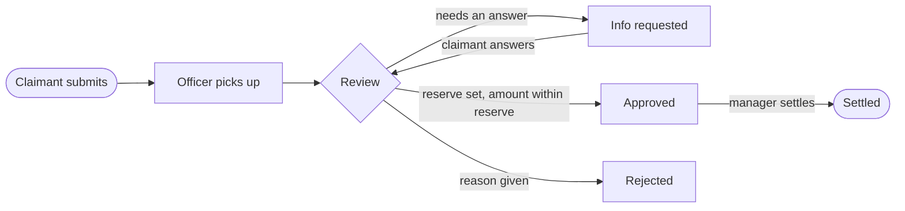
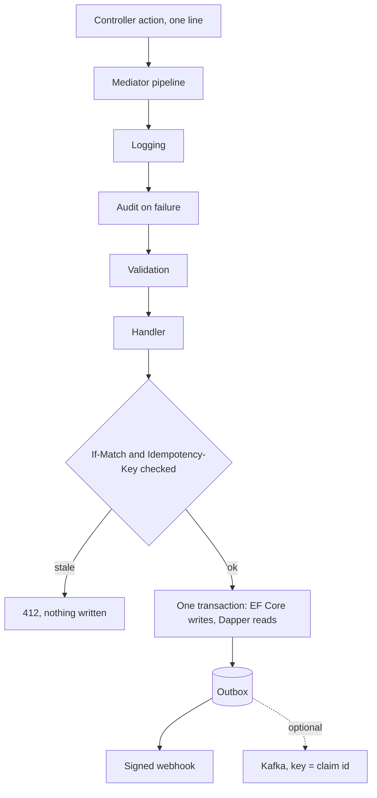
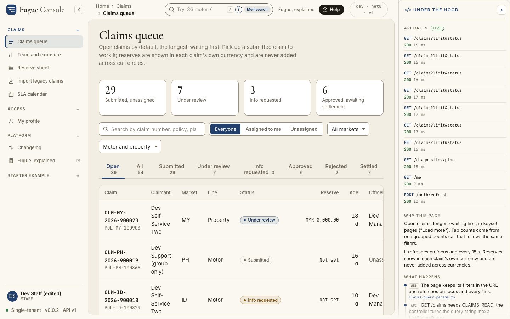
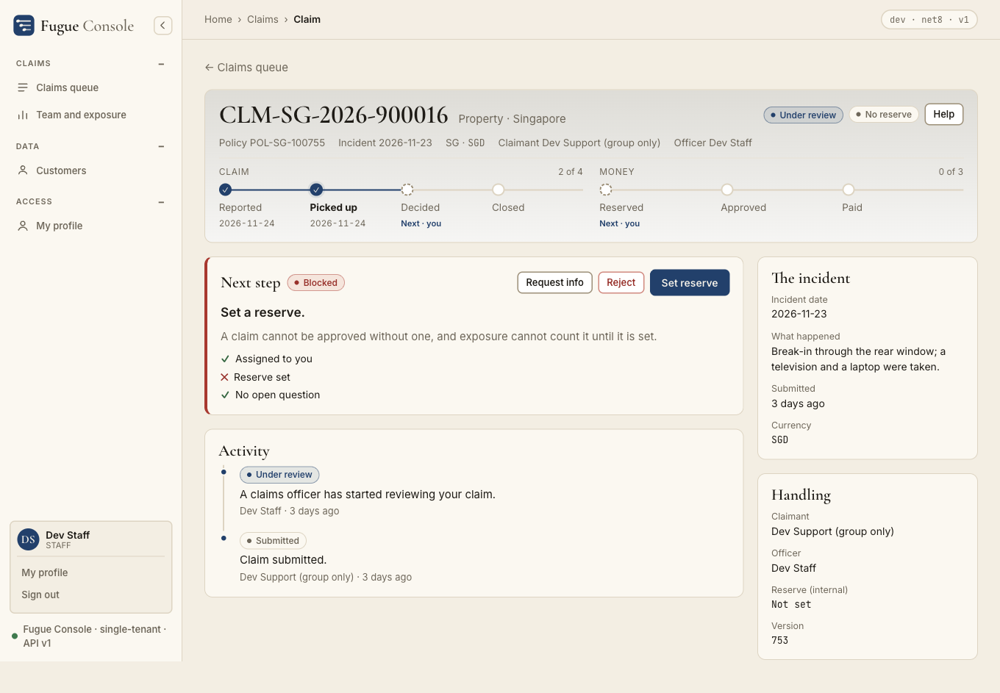
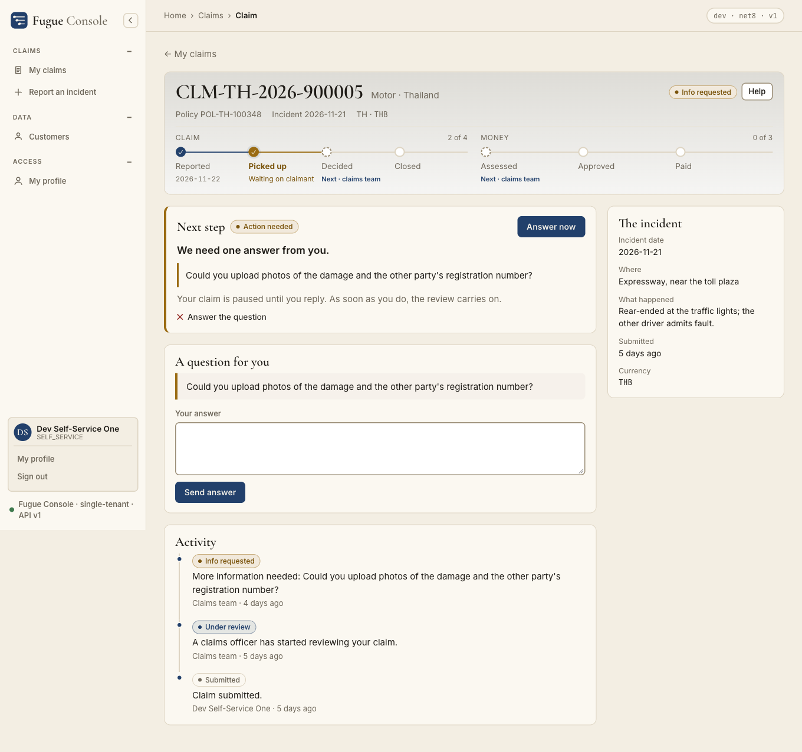
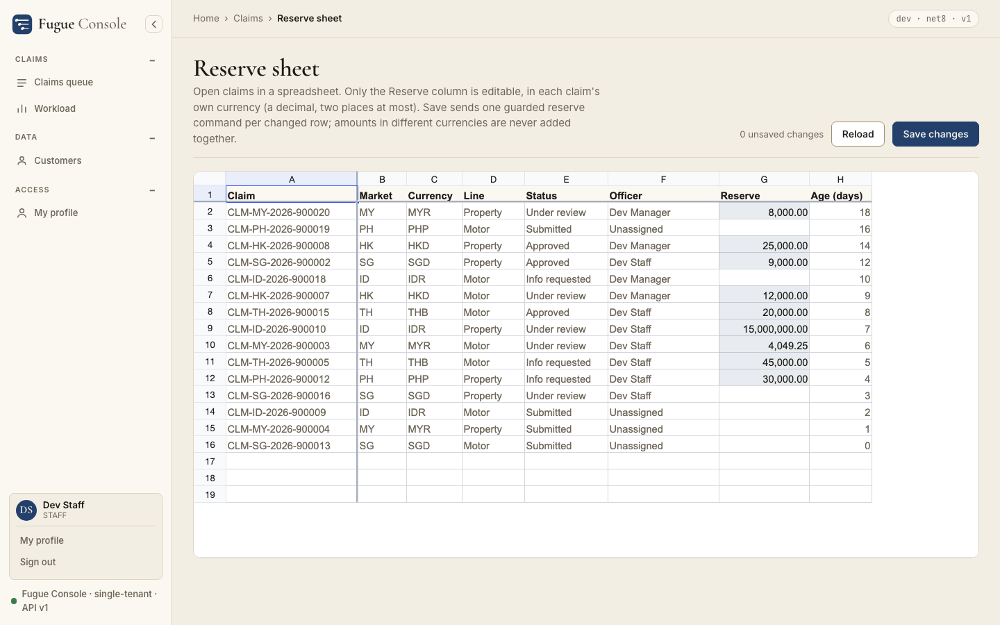
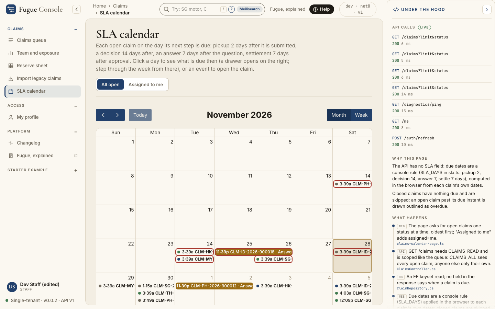
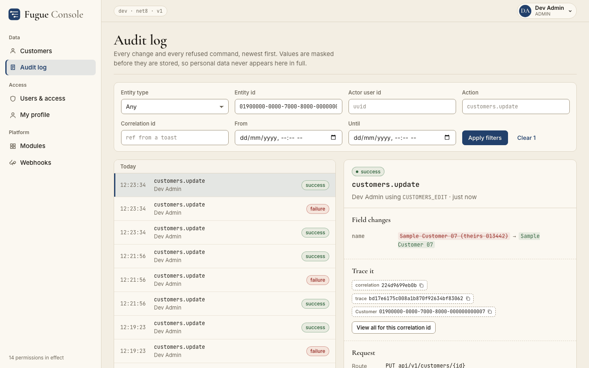

# Fugue

**One request, heard in every voice.**


A claims platform for motor and property claims across six APAC markets (SG, MY, TH, HK, ID, PH): a .NET 8 API and one Angular console for claimants, claims officers, managers and admins. It is a take-home build, so it says plainly what it does and does not do.

---

## Run it

You need Docker and nothing else. Postgres, the migrations, the seed data and the search service all run in containers.

```bash
git clone https://github.com/triunai/fugue-control-room.git
cd fugue-control-room
./start.sh
```

`./start.sh` does this, and only this:

- creates `.env` from `.env.example` with fresh random secrets, if `.env` does not exist;
- moves any host port that is already taken (Postgres 5432, console 8080, API 5081, Meilisearch 7700) to the next free one;
- runs `docker compose up -d --build`: Postgres 17, a one-shot `migrate` container that applies the migrations and seeds the accounts and claims, the API, Meilisearch and the console;
- waits until the console answers, then prints the URLs and the four accounts.

It is safe to run again. It does not install anything on the host, and it does not touch a `.env` you already have. Stop with `docker compose down` (`down -v` also deletes the data).

The same by hand (or on Windows without Git Bash):

```bash
cp .env.example .env
sed -i.bak "s|REPLACE_ME|$(openssl rand -hex 16)|g; s|GENERATE_WITH_openssl_rand_base64_32|$(openssl rand -base64 32)|g" .env && rm .env.bak
docker compose up -d --build
docker compose ps
```

Open **http://localhost:8080** (console). The API is on **:5081**, Swagger at `/swagger`. The sign-in page lists the seeded accounts; all share the development-only password `Fugue-Dev-Passw0rd!`.

| Account | Role | Lands on |
|---|---|---|
| `self@fugue.test` | claimant | the claim that needs them ("We need one answer from you"); can answer it, report an incident, follow the claim |
| `staff@fugue.test` | claims officer | My work: needs my action, pick up next, waiting on claimant; the claim record's next-step card; reserve sheet; SLA calendar |
| `manager@fugue.test` | manager | To settle; Team and exposure per currency |
| `admin@fugue.test` | admin | everything: users, the roles x permissions matrix, audit log with search, module toggles, webhooks |

Where things live: the migration catalog is [`docs/migrations/migration-catalog.md`](docs/migrations/migration-catalog.md), the release history is [`CHANGELOG.md`](CHANGELOG.md), and the step-by-step guide for a clean clone is [`docs/runbooks/00-for-reviewers.md`](docs/runbooks/00-for-reviewers.md). A curl walk-through of every guard (404, 409, 412, 428, the required Idempotency-Key) is [`docs/runbooks/11-claims.md`](docs/runbooks/11-claims.md).

**Agent tooling.** The stack creates a SELECT-only Postgres role so an AI agent can explore the data through a read-only MCP server (two layers of defence: the role refuses writes, the server runs in restricted mode), and the day-to-day loop is plain CLI (psql, Bruno, headless Playwright). A ten-minute demo script with the commands: [`docs/runbooks/agent-tooling.md`](docs/runbooks/agent-tooling.md).

The timed claims build is the git range `claims-window-start..claims-window-end`. The starter under it (auth, audit, outbox, idempotency, console shell, Docker stack) was built first and is disclosed in [Beyond the brief](#beyond-the-brief-and-the-starter).

---

## What is Fugue?

A claim touches three audiences and several systems: the claimant who reports it, the officer who decides it, the manager who pays it, and whatever sits downstream (notifications, payments, finance). The usual way to build that is a status column and a pile of side effects. When one of the side effects fails, the status and the story disagree.

```text
BEFORE                                         AFTER
Claim row updated.                             One transaction commits all four:
Email sent, maybe.                               - the claim's new state
Audit written, if someone remembered.            - the claimant-facing timeline row
Event published, if the broker was up.           - the append-only audit row
Two officers edit at once: last write wins.      - the outbox event
Double-click files two claims.                 Stale edit: 412, nothing written.
                                               Retry with the same key: the first answer.
                                               Not your claim: 404, same as "does not exist".
```

A fugue is several independent voices on one subject. Here the subject is a request, and the voices are the claimant's timeline, the admin's audit log, and the events other systems consume. One request, heard in every voice, in one transaction.

### The life of a claim



### The life of one request



---

## Key capabilities

- **A guarded state machine.** Submitted, UnderReview, InfoRequested, Approved, Rejected, Settled. Every move is a method on the `Claim` aggregate that returns a result; an illegal move changes nothing and answers 409.
- **Scoping that answers 404, not 403.** A claim outside your scope looks exactly like a claim that does not exist, so ids reveal nothing. The reserve and the officer's name never reach a claimant.
- **Optimistic concurrency with the database version.** The ETag is Postgres `xmin`. A stale `If-Match` is 412, a missing one is 428, and both are checked before the state machine.
- **Duplicate-proof submits.** `POST /claims` requires an `Idempotency-Key`; a retry replays the first response, and a reused key is 422.
- **A transactional outbox.** State, timeline row, audit row and event commit together or not at all. Events leave through signed webhooks; a Kafka publisher is optional and off by default.
- **An append-only audit trail.** Field-level diffs, failure rows for rejected commands, and no way to write to it through the API.
- **Search that degrades honestly.** Meilisearch backs audit search and claim search (claim number, policy number, place, description, claimant name; typo tolerant). Claim search applies the caller's scope itself. When the engine is down the endpoint answers 503, not an empty list.
- **Excel in the console.** A reserve sheet and a claim assessment worksheet (Univer) with Save to Excel.
- **An SLA calendar** (FullCalendar, lazy-loaded).
- **Team and exposure, per currency.** Per officer: open load, oldest claim, decisions in 7 and 30 days, median days to decision. Exposure per market, line and currency; there is no grand total, because SGD plus IDR needs a rate and a rate date.
- **A console that explains itself.** Every page has an "Under the hood" panel: the live API calls, how the API does it, the guards with the real enforcing code, the tests that cover the page, and the ADRs.

### The console

Screenshots below are captured by the Playwright suite (`cd web && npm run screenshots`).

| Claims queue | Officer's claim record | Claimant's claim record |
|---|---|---|
|  |  |  |

| Reserve sheet | SLA calendar | Audit diff |
|---|---|---|
|  |  |  |

---

## How it works

```text
 Angular console (one app: claimant, officer, manager, admin)
   navigation and buttons come from permission codes in GET /me, never role names
        |
        |  REST: the caller needs the guard's verdict now
        v
 +--------------------------- one deployable, one Postgres ---------------------------+
 |  Controller (one line per action, [HasPermission])                                  |
 |        |                                                                            |
 |        v   Mediator (source-generated)                                              |
 |  Logging -> Audit (failures) -> Validation -> Handler                               |
 |                                                  |                                  |
 |                                                  v   ONE TRANSACTION                |
 |   claims + timeline + info requests  |  audit_log (append-only)  |  outbox          |
 +--------------------------------------------------------------------|----------------+
                                                                      | async, at least once
                                                                      v
                                                          IEventPublisher
                                                          |                 |
                                              signed webhooks        Kafka (optional)
                                              (claim.*.v1)           key = claim id
```

Commands are REST because the caller needs the answer now. Every transition is also an event, so anything that only reacts to a claim (notifications, payments, finance reporting) can become its own service without a distributed transaction. The reasoning, including the REST versus Kafka question, is in [`docs/CLAIMS.md`](docs/CLAIMS.md).

---

## Architecture

```text
src/
  Fugue.Domain          aggregates (Claim and its state machine), typed ids, errors
  Fugue.Application     feature slices (Features/Claims: commands, queries, scope), pipeline behaviours, ports
  Fugue.Infrastructure  EF Core + Dapper persistence, migrations, outbox and webhooks, audit, seeders
  Fugue.Api             one-line controller actions, auth, idempotency filter, problem details
tests/
  Fugue.Tests           unit + Testcontainers integration + full-host HTTP tests
  Fugue.ArchTests       layering and fitness rules (baselines may only shrink)
  Fugue.MutationTests   Stryker.NET project for the mutation runs
  pict/                 pairwise case models
web/                    the Angular console (TanStack Query, NgRx SignalStore, generated client)
bruno/fugue             HTTP regression collection (claims/ is the window's folder)
perf/k6                 load scripts
scripts/                repo tooling and git-hook checks (scripts/spine/)
docs/                   claims domain, architecture, ADRs, runbooks, decisions, journal
```

The dependency rule and the vertical slices are explained in [`docs/ARCHITECTURE.md`](docs/ARCHITECTURE.md); architecture tests enforce them.

---

## Stack

| Part | Technology | Notes |
|---|---|---|
| API | ASP.NET Core MVC on .NET 8 | Controllers are one line each; `.NET 8` is pinned by `global.json` |
| Mediation | Mediator (source-generated) | Logging, audit and validation behaviours wrap every handler |
| Validation and errors | FluentValidation, FluentResults | Typed errors become RFC 9457 problem details |
| Persistence | EF Core (writes), Dapper (reads) | One transaction per command, ADR-006 |
| Database | PostgreSQL 17 | `xmin` is the ETag |
| Search | Meilisearch | Optional service; indexed from the append-only audit log and from claims |
| Events | Transactional outbox, signed webhooks | Kafka (Redpanda in compose) behind the `kafka` profile, off by default |
| Console | Angular 22, TanStack Query, NgRx SignalStore | API client generated from the committed OpenAPI snapshot |
| Tests | xUnit, Testcontainers, NetArchTest, Vitest, Playwright, Bruno | Details under Reference |
| Packaging | Docker Compose | `./start.sh` wraps it |

---

## Why the name

A fugue is a piece where independent voices state the same subject and answer each other. A claim does the same thing: the claimant reads a timeline, the admin reads an audit log, another system reads an event. They are three records of one thing that happened, and they must not disagree. The name is the design constraint, not decoration.

> A green command is evidence of what it ran. The tests are the specification the code cannot argue with.

---

# Reference

<details>
<summary><strong>API conventions and error codes</strong></summary>

- Base path `/api/v1`. Errors are `application/problem+json` with a stable `code`.
- Every state-changing action on an existing claim needs `If-Match` (the ETag from the last read). Missing: **428**. Stale: **412**. Both are checked before the state machine.
- `POST /claims` needs an `Idempotency-Key` header. A reused key: **422**.
- A claim outside the caller's scope: **404**, never 403. A missing permission: **403**.
- An illegal transition, a missing reserve, an amount above the reserve: **409** or **422** with a `claim.*` code (`claim.not_found`, `claim.invalid_transition`, `claim.reserve_required`, `claim.amount_invalid`, `claim.info_request_not_found`).
- Search unavailable: **503** (`search.unavailable` on claim search).
- The contract is generated from the controllers, pinned by `docs/api/openapi.v1.json` (a test regenerates it), and the Angular client is generated from it.

See [`docs/ARCHITECTURE.md`](docs/ARCHITECTURE.md) sections 6 and 7 and [`docs/runbooks/11-claims.md`](docs/runbooks/11-claims.md).
</details>

<details>
<summary><strong>Personas and permissions</strong></summary>

| Move | Permission | Also checked | Event |
|---|---|---|---|
| Submit | `CLAIMS_SUBMIT` | the claimant is the caller, never a body field | `claim.submitted.v1` |
| Pick up | `CLAIMS_HANDLE` | assigns the caller | `claim.assigned.v1` |
| Reserve, ask, decide | `CLAIMS_HANDLE` | the assigned officer, or a manager | `claim.reserve.set.v1`, `claim.info.requested.v1`, `claim.decided.v1` |
| Answer a question | `CLAIMS_RESPOND` | the claim is the caller's own | `claim.info.provided.v1` |
| Settle | `CLAIMS_SETTLE` | Approved only | `claim.settled.v1` |

Approving needs a reserve and an amount with 0 < amount <= reserve. At most one open question per claim, enforced by the database. Roles, groups, overrides and the roles x permissions matrix: [runbook 05](docs/runbooks/05-auth.md).
</details>

<details>
<summary><strong>Tests: counts and how to run each</strong></summary>

```bash
dotnet test                                               # Fugue.Tests and Fugue.ArchTests; needs Docker (Testcontainers)
cd web && npm ci && npm test                              # console unit tests (Vitest)
cd web && npm run e2e                                     # Playwright flows against the running stack
npm ci && (cd bruno/fugue && npx bru run --env compose)   # API regression suite against the Docker stack
```

| Suite | Size (v0.0.2) | Runs against |
|---|---|---|
| `Fugue.Tests` (xUnit) | about 740 cases | a real Postgres 17 (Testcontainers) or the full HTTP host, plus in-process tests of the state machine, validators and mapping |
| `Fugue.ArchTests` (NetArchTest) | 37 fitness functions | layering, one-line controllers, every action declares a permission; baselines may only shrink |
| Bruno | 101 requests, 123 tests (per CHANGELOG) | the Docker stack: every guard (404, 409, 412, 428, 422) over HTTP |
| Console (Vitest) | roughly 200 tests; the exact count moves with each merge | `cd web && npm test` |
| Console e2e (Playwright) | 20 flows in a browser, claimant to settlement | `web/e2e/` |

Counts drift as lanes merge; the totals at release are in [`CHANGELOG.md`](CHANGELOG.md).

**Why this many, and why these.** The code was written mostly by AI agents, so the tests are the specification they cannot argue with: each pins an invariant of the domain ("a stale ETag is 412 and nothing is written", "outside your scope is 404, never 403", "exposure is never summed across currencies", "the audit log cannot be written through the API"). They are deterministic on purpose: a real database instead of mocks of it, time-dependent rules on a fake clock (`FakeTimeProvider`), waits that are bounded polls or timeouts and never sleep-then-assert. A red test therefore means the code drifted, not that the test flaked. The hooks run them before every push, so drift does not reach the remote.

Also in the repo: Stryker.NET mutation runs (`npm run mutation:claim`), PICT pairwise models (`tests/pict/`), k6 load scripts (`npm run perf:queue`, `perf:submit`, `perf:race`). See [`docs/quality/README.md`](docs/quality/README.md) and [`perf/k6/README.md`](perf/k6/README.md).
</details>

<details>
<summary><strong>Bruno collection</strong></summary>

`bruno/fugue` is the HTTP regression suite. Environments: `local` (`npm run api:test`) and `compose` (`npm run api:test:compose`, against the Docker stack). The `claims/` folder is the window's; `auth/`, `audit/`, `idempotency/`, `webhooks/` and the rest are the starter's. Step 5 of [runbook 00](docs/runbooks/00-for-reviewers.md) runs it.
</details>

<details>
<summary><strong>Runbooks</strong></summary>

Every step is copy-pasteable and says what you should see. Index: [`docs/runbooks/README.md`](docs/runbooks/README.md).

| Runbook | Use it to |
|---|---|
| [00](docs/runbooks/00-for-reviewers.md) | Run the stack, sign in, run the tests and the API suite |
| [01](docs/runbooks/01-local-setup.md) | Install tools, build, test |
| [02](docs/runbooks/02-tracing-a-request.md) | Send a request, find it in logs, read a problem detail |
| [03](docs/runbooks/03-local-database.md) | Postgres, migrate, seed |
| [05](docs/runbooks/05-auth.md) | Sign in, call as each role, modules |
| [06](docs/runbooks/06-audit.md) | Query the audit log, read a diff, try to tamper |
| [07](docs/runbooks/07-webhooks.md) | Subscribe the dev sink, verify a signature, redeliver |
| [09](docs/runbooks/09-console.md) | Run the console, regenerate the client, e2e |
| [10](docs/runbooks/10-docker-compose.md) | The compose stack: ports, accounts, reset |
| [11](docs/runbooks/11-claims.md) | The claims platform with curl, guard by guard |
| [12](docs/runbooks/12-kafka.md) | Run the optional Kafka broker and watch claim events |
| [Load testing](docs/runbooks/load-testing.md) | k6 smoke, load and stampede runs, percentile reports, before/after overlay (`load/`) |
</details>

<details>
<summary><strong>Decisions and ADRs</strong></summary>

Every decision is numbered (D-NNN) in [`docs/decisions.md`](docs/decisions.md). Architecture records are in [`docs/adr/`](docs/adr/): shared-DB tenant id, controllers, typed errors, trace and saga ids, EF writes with Dapper reads, AI harness gates, auth and identity, module management, audit log, outbox and signed webhooks, OpenAPI and the console boundary, idempotency keys (ADR-001 to ADR-013). The claims plan, with its cut lines, is [`docs/plans/claims-window.md`](docs/plans/claims-window.md); cross-family reviews and how each finding was handled are in [`docs/reviews/`](docs/reviews/).
</details>

<details>
<summary><strong>How it was built with AI</strong></summary>

The whole repo was built by AI agents under a lead, with mechanical gates and cross-family review. The working journal is a deliverable: [`docs/ai-journal.md`](docs/ai-journal.md) records what was asked, what the AI proposed, what was accepted, overridden or challenged, and why.

- **Lanes.** Each piece of work is a lane with a written brief and a status file ([`docs/ai/lanes/`](docs/ai/lanes/), [`docs/ai/briefs/`](docs/ai/briefs/)).
- **Worktrees.** One git worktree per write lane, so one agent's staged files cannot ride along in another's commit.
- **Hooks.** lefthook runs the gates: secrets scan, `dotnet format`, commitlint and a `Refs:` trailer on agent commits at commit time; build and tests before push. A Claude Code PreToolUse guard blocks force pushes, `--no-verify` and similar. See [`AGENTS.md`](AGENTS.md).
- **Failure-modes log.** Every trap actually hit, with its cause and the move that defuses it: [`docs/failure-modes.md`](docs/failure-modes.md).
- **Operating model.** [`docs/ai/how-we-use-ai.md`](docs/ai/how-we-use-ai.md), [`docs/ai/harness.md`](docs/ai/harness.md), [`docs/HOW-WE-WORK.md`](docs/HOW-WE-WORK.md).
</details>

<details>
<summary><strong>Beyond the brief, and the starter</strong></summary>

The starter (built 2026-11-25 to 2026-11-27, before the window, disclosed): layered vertical slices, typed errors as RFC 9457 problems, ETag/If-Match concurrency, keyset paging, JWT auth with roles, groups, overrides and module toggles, an append-only audit log, a transactional outbox with signed webhooks, idempotency keys, an OpenAPI snapshot with a generated Angular client, the console shell and the Docker stack. It carries a `Customers` example and no claims code.

The timed window starts at tag `claims-window-start` and ends at `claims-window-end` (`git log claims-window-start..claims-window-end`). What follows the second tag is listed here; each is documented where it lives, and kept out of the demo script ([`docs/DEMO.md`](docs/DEMO.md)) on purpose.

| Extra | Where |
|---|---|
| Console shell from the owner's reference design; a reviewer tour per persona and page (Help, `?tour=off`) | `web/src/app/features/shell/` |
| Univer reserve sheet and assessment worksheet with Save to Excel; FullCalendar SLA calendar (bundle cost in `web/README.md`) | `web/src/app/features/claims/` |
| Meilisearch audit search and claim search (optional service) | [runbook 06](docs/runbooks/06-audit.md) |
| Kafka publisher behind the event port (optional compose profile) | [runbook 12](docs/runbooks/12-kafka.md), [ADR-011](docs/adr/ADR-011-outbox-and-signed-webhooks.md) |
| Mutation testing (Stryker.NET), pairwise cases (PICT), k6 load scripts | [`docs/quality/`](docs/quality/README.md), `perf/k6/` |
| How the AI harness runs this repo | [`docs/ai/harness.md`](docs/ai/harness.md) |
</details>

---

## Development

```bash
# API (prefix once per shell if dotnet lives in ~/.dotnet)
export DOTNET_ROOT=$HOME/.dotnet PATH=$HOME/.dotnet:$PATH
dotnet restore && dotnet build --no-restore && dotnet test --no-build

# Console
cd web
npm ci
npm start          # ng serve; proxies to the API (web/proxy.conf.json)
npm test           # Vitest, single run
npm run lint
npm run build
npm run api:gen    # regenerate the client from docs/api/openapi.v1.json
npm run e2e        # Playwright

# Repo root
npm install                  # installs lefthook and commitlint (the prepare script runs lefthook install)
npm run api:openapi          # refresh the OpenAPI snapshot
npm run api:test:compose     # Bruno against the Docker stack
npm run db:script            # idempotent migration SQL
npm run test:scripts         # tests for the repo's own scripts
```

Optional Kafka: `EVENTS_PUBLISHER=Both docker compose --profile kafka up -d --build` ([runbook 12](docs/runbooks/12-kafka.md)). Local setup without Docker for the API: [runbook 01](docs/runbooks/01-local-setup.md) and [runbook 09](docs/runbooks/09-console.md). Commit messages follow Conventional Commits, enforced by commitlint.

---

## Status and roadmap

| Piece | State |
|---|---|
| Claims domain: state machine, timeline, info requests, reserve, decide, settle | Built, tested |
| Scoping (404), If-Match (412, 428), Idempotency-Key (422) | Built, tested |
| Outbox, signed webhooks, dev sink | Built, tested |
| Kafka publisher | Built, optional, off by default |
| Audit search and claim search (Meilisearch) | Built, optional service, 503 when down |
| Workload and exposure, per currency | Built, live SQL, refreshed every 15 s |
| One-command Docker stack | Built (`./start.sh`) |
| CI workflow (`.github/workflows/ci.yml`) | Written, not yet run on a real remote |
| Hosting | Not set up. It runs locally in Docker |
| Exposure projection fed by claim events | Not built (live SQL today) |
| Settlement saga with a payments consumer, payment failure | Not built |
| Fraud and SLA rules as event consumers | Not built |
| Attachments (object storage, virus scan), property-specific fields | Not built |
| Per-market business calendars for ageing | Not built |
| Splitting claims into its own deployable | Not built; the module line exists |

Those are roadmap items, not creatively worded existing features. The domain reasoning for each cut is in [`docs/CLAIMS.md`](docs/CLAIMS.md) section 8.

---

## License

No license file: all rights reserved by the author.
