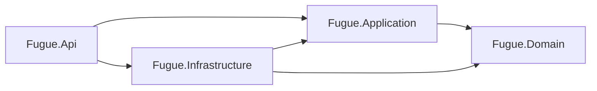
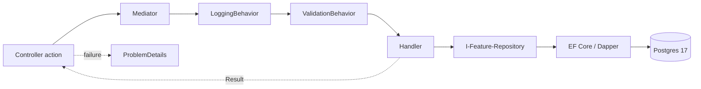

# Fugue

An over-engineered-on-purpose **.NET 8 REST API scaffold**: vertical slices inside a clean-architecture core, built to practise production API patterns, together with an AI-native engineering harness that keeps the work honest.

The name is from Bach: a fugue is independent voices over one shared subject, much like independent feature slices over one shared core. It carries no business domain; `Customers` is the worked example.

## Status

Early and honest. Verified on 2026-11-25 (see [`docs/hot-state.md`](docs/hot-state.md)):

- **Done:** S0 scaffold, S1 validation/logging/correlation, S2 persistence (Postgres, EF Core + Dapper, Customers slice), S3 identity (JWT, permissions, ownership, modules, groups, overrides), W-012 rich append-only audit log, S4 transactional outbox with signed webhooks, H1 AI harness.
- **In progress:** nothing on the board that is not parked; S3 review follow-ups (W-013) are next. The S3 plan was rejected by a cross-model review with 10 findings, all accepted ([review](docs/reviews/codex/2026-11-25-s3-identity-plan.md)).
- **Planned:** S5 REST hardening.
- **Tests:** the whole suite is expected green; anything red is a real bug.
- No CI workflow yet; gates run locally through git hooks.

## Highlights

Each pattern points at where it lives.

- **One-liner controllers.** Actions only dispatch; logic lives in handlers ([ADR-002](docs/adr/ADR-002-controllers-with-api-controller-base.md)).
- **FluentResults to RFC 9457 ProblemDetails**, with our own `ErrorType`; transient database failures surface as `503` plus `Retry-After` ([ADR-004](docs/adr/ADR-004-fluentresults-with-errortype.md), `GlobalExceptionHandler`).
- **FluentValidation in the mediator pipeline**, aggregated into one validation problem (`ValidationBehavior`).
- **Correlation and saga IDs** echoed on responses and pushed to logs and traces ([ADR-005](docs/adr/ADR-005-trace-correlation-saga-ids.md)).
- **EF Core reads and `xmin` concurrency, Dapper writes**, on one shared unit of work ([ADR-006](docs/adr/ADR-006-ef-core-reads-dapper-writes.md)).
- **ETag / `If-Match`** with `412` for stale and `428` for missing preconditions.
- **Keyset pagination** with RFC 8288 `Link` headers (no offset paging).
- **Typed UUIDv7 IDs** (`CustomerId`), wired through EF, Dapper, JSON and route binding.
- **Audit stamping** on both the EF and Dapper write paths.
- **Rich audit log** (`audit_log`): who, what, field-level old/new values, outcome and error code, request and trace ids; written in the SAME transaction as the change, append-only by trigger, masked before it is stored, queryable at `GET /api/v1/audit` behind `AUDIT_READ` ([ADR-010](docs/adr/ADR-010-audit-log.md), [runbook](docs/runbooks/06-audit.md)).
- **Transactional outbox and signed webhooks**: events are written in the same transaction as the change, relayed with `SKIP LOCKED`, and sent as HMAC-SHA256 signed requests with backoff, dead letter, redeliver, and an SSRF guard that checks again at connect time ([ADR-011](docs/adr/ADR-011-outbox-and-signed-webhooks.md), [runbook](docs/runbooks/07-webhooks.md)).
- **Real-database tests** via Testcontainers, plus a **Bruno CLI** HTTP regression suite.
- **Architecture fitness functions** with shrink-only baselines (`tests/Fugue.ArchTests`).

## Architecture at a glance





`Fugue.Domain` and `Fugue.Application` never reference ASP.NET Core, EF, Dapper or Npgsql; an architecture test enforces it. A feature is one vertical slice:

```
Fugue.Application/Features/<Feature>/I<Feature>Repository.cs
Fugue.Application/Features/<Feature>/Commands|Queries/<Verb><Noun>.cs   (contract, validator, handler)
Fugue.Infrastructure/Persistence/<Feature>/                              repository implementation
Fugue.Api/Controllers/<Feature>Controller.cs                             one-liner actions
```

## Quickstart

Takes about 10 minutes on macOS. Full detail with expected output for every step: [runbook 01](docs/runbooks/01-local-setup.md) and [runbook 03](docs/runbooks/03-local-database.md).

**Prerequisites:** .NET 8 SDK (`global.json` pins 8.0.428; install with `dotnet-install` into `~/.dotnet`), Docker (OrbStack on macOS), Node.js (git hooks and Bruno only).

```bash
export DOTNET_ROOT=$HOME/.dotnet PATH=$HOME/.dotnet:$PATH
dotnet --version            # 8.0.428

npm install && npx lefthook install    # hooks + commitlint; ends with "sync hooks"
cp .env.example .env                   # then set one password in both places
set -a; source .env; set +a

docker compose up -d                   # Postgres 17; `docker compose ps` shows (healthy)
dotnet tool restore
dotnet ef database update --project src/Fugue.Infrastructure   # "Done."

export ASPNETCORE_ENVIRONMENT=Development ASPNETCORE_URLS=http://localhost:5080
dotnet run --project src/Fugue.Api -- --seed   # logs "Seeded 25 development customers"
```

In another shell:

```bash
curl -si 'http://localhost:5080/api/v1/diagnostics/ping?count=3'
# HTTP/1.1 200 OK, an X-Correlation-Id header, body {"message":"pong","count":3}

npm run api:test                       # Bruno suite against the running API
```

Port 5432 taken by a host Postgres? Use `POSTGRES_PORT=5433` and `Port=5433` in `.env`. `npm run api:test` runs the Bruno suite against the running API ([runbook 04](docs/runbooks/04-customers-api.md)).

## Running tests

```bash
dotnet build                       # 0 warnings; warnings are errors
dotnet test --no-build             # unit + integration + architecture
npm run test:scripts               # tests for the repo's own hook scripts
```

- `tests/Fugue.Tests`: unit and integration tests; persistence tests start Postgres through Testcontainers.
- `tests/Fugue.ArchTests`: layering rules and fitness functions (baselines in `tests/Fugue.ArchTests/Baselines/` may only shrink).
- With OrbStack the Docker socket may not be at `/var/run/docker.sock`; set `DOCKER_HOST` as shown in [runbook 03](docs/runbooks/03-local-database.md).
- Bruno: `npm run api:test` (needs the API and database running).

## Project layout

```
src/Fugue.Domain          entities, typed ids, FugueError/ErrorType, audit abstractions
src/Fugue.Application     feature slices, pipeline behaviors, repository interfaces
src/Fugue.Infrastructure  DbContext, migrations, Dapper SqlExecutor, unit of work, seeder
src/Fugue.Api             controllers, ApiControllerBase, middleware, composition root
tests/                    Fugue.Tests, Fugue.ArchTests
bruno/fugue               HTTP regression collection
docs/                     ADRs, runbooks, plans, failure modes, project log
scripts/                  hook scripts and doc-lifecycle tooling (Node)
.claude/skills            project skills used by the AI harness
```

## Engineering workflow and AI harness

Work is planned and reviewed with AI agents under mechanical gates. [`docs/ai/how-we-use-ai.md`](docs/ai/how-we-use-ai.md) is the candid account and tags each practice as live in this repo or practised elsewhere. Failure history: [`docs/failure-modes.md`](docs/failure-modes.md).

- **Doc lifecycle** ([`hygiene.md`](hygiene.md)): a workstream (`W-`) is captured before work, closed into [`docs/project-log.md`](docs/project-log.md) and [`CHANGELOG.md`](CHANGELOG.md), then archived. [`docs/hot-state.md`](docs/hot-state.md) is the single resume point.
- **Commits:** Conventional Commits with scopes; agent commits carry a `Refs: W-/D-/ADR-` trailer; a `fix(...)` touching `src/` must touch `tests/` or say `Tests: none (<reason>)`. Retros use a `Do better:` line.
- **Gates (lefthook):** secrets scan, `dotnet format`, commitlint, build and tests at push, ledger and ADR checks, advisory test-integrity check, and an advisory seam-triggered Codex cross-model review. A safe-command guard protects agent shell use. Do not bypass hooks with `--no-verify`.
- **Critical seams** (auth, migrations, `ApiControllerBase`) need a written plan and an independent review before code ([`AGENTS.md`](AGENTS.md)).

## Decisions

| ADR | Decision |
|---|---|
| [001](docs/adr/ADR-001-shared-db-tenant-id.md) | Shared DB with `tenant_id` (superseded by 003) |
| [002](docs/adr/ADR-002-controllers-with-api-controller-base.md) | MVC controllers on an abstract `ApiControllerBase` |
| [003](docs/adr/ADR-003-single-tenant-default-tenancy-toggle.md) | Single-tenant by default; tenancy is a config toggle |
| [004](docs/adr/ADR-004-fluentresults-with-errortype.md) | FluentResults with our own `ErrorType` |
| [005](docs/adr/ADR-005-trace-correlation-saga-ids.md) | Trace, correlation and saga IDs |
| [006](docs/adr/ADR-006-ef-core-reads-dapper-writes.md) | EF Core reads and concurrency, Dapper inserts and set-based writes |
| [007](docs/adr/ADR-007-ai-harness-gates.md) | AI harness gates: local beads, commit gates, advisory cross-model review |

Running log of smaller calls: [`docs/decisions.md`](docs/decisions.md).

## Roadmap

Full plan in [`docs/plans/roadmap.md`](docs/plans/roadmap.md).

- **S3 identity:** JWT bearer, two role policies, ownership authorization with `404` for cross-scope misses.
- **S4 outbox and webhooks:** outbox written in the business transaction, HMAC-signed webhooks, resilient delivery, dead-lettering.
- **S5 REST hardening:** idempotency keys, API versioning with `Deprecation`/`Sunset`, rate limiting, caching, OpenTelemetry, health checks, OpenAPI snapshot test, Dockerfile.

## Contributing and conventions

File-scoped namespaces, nullable reference types on, one-liner controller actions, handlers return FluentResults, every migration updates `docs/migrations/migration-catalog.md` in the same commit, and every review catch gets a regression test. Details: [`CLAUDE.md`](CLAUDE.md) and [`AGENTS.md`](AGENTS.md).

## License

Not yet chosen.
