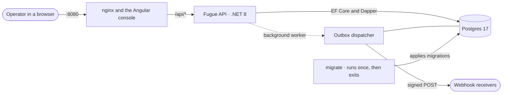
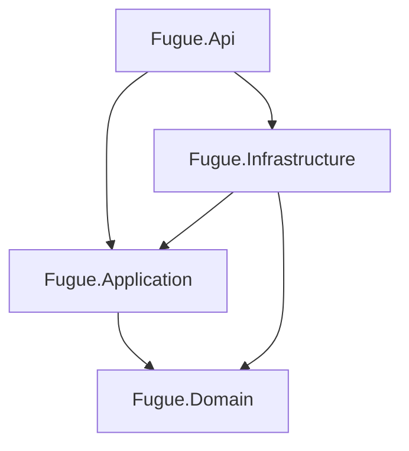
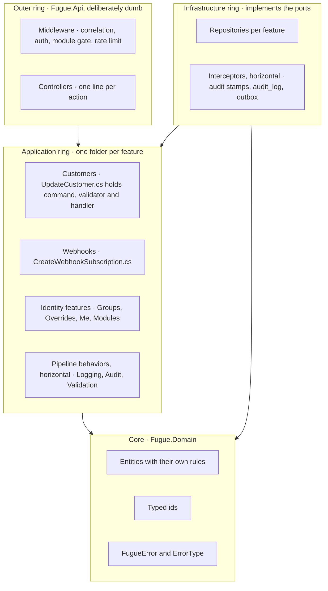
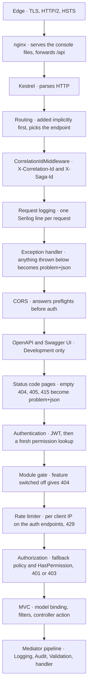
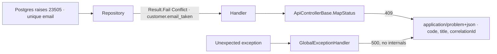
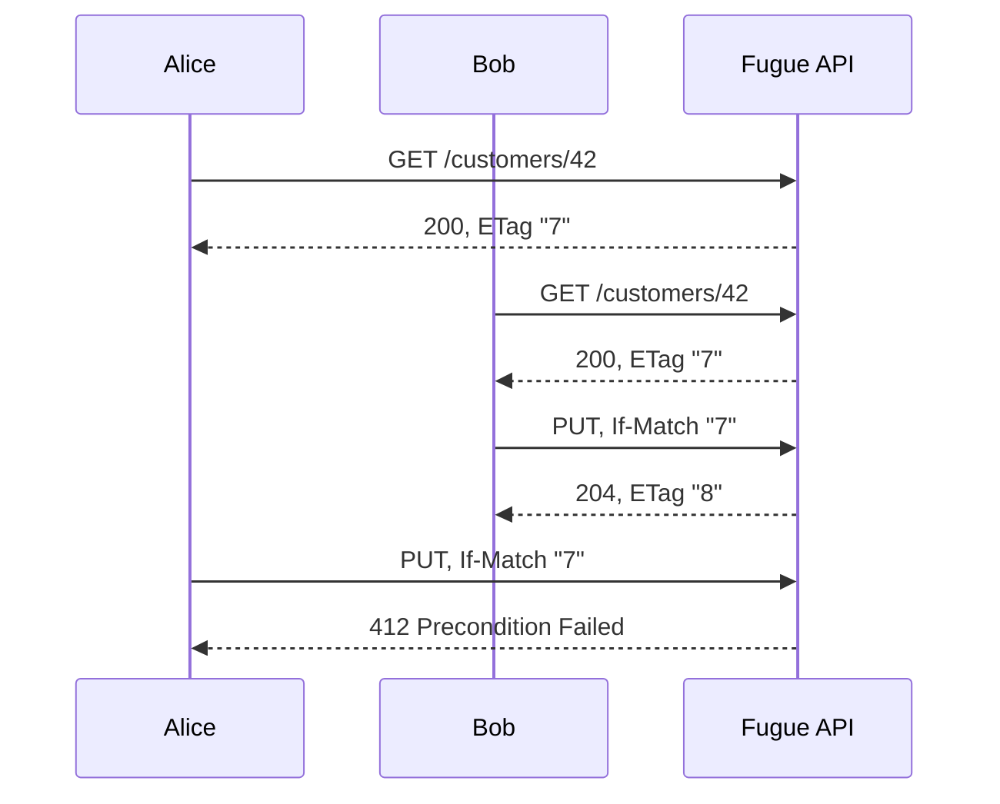
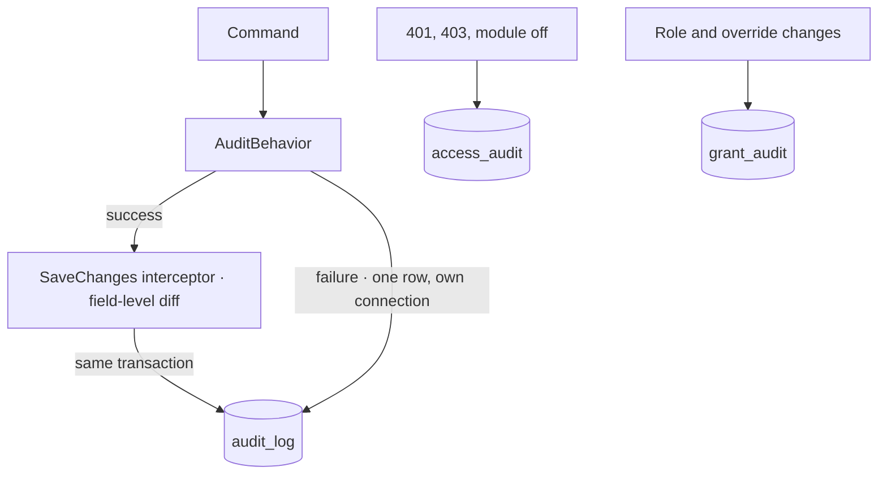
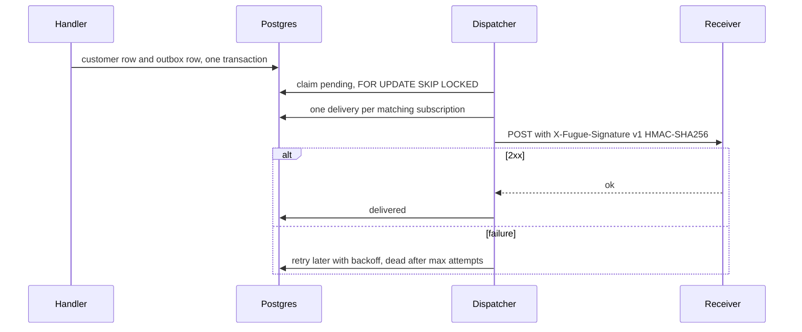

# Fugue architecture

Fugue is a .NET 8 Web API with no business domain on purpose. It exists to show the parts every real API needs, done properly: layered code, typed errors, safe concurrent edits, permissions, an audit trail nobody can edit, signed webhooks and retry-safe creates. An Angular console in `web/` makes that behaviour visible.

The only sample aggregate is `Customer`, a neutral stand-in for any stateful record. Rules and reasons live in the ADRs; this page is the map. Decisions are in [`docs/adr/`](adr/), the live status is in [`docs/hot-state.md`](hot-state.md).



`docker compose up` starts all of it ([`docker-compose.yml`](../docker-compose.yml), [runbook 10](runbooks/10-docker-compose.md)). `migrate` is a one-shot container: the API never changes the schema itself.

## 1. The four projects and the dependency rule

| Project | Holds | May reference |
|---|---|---|
| `Fugue.Domain` | entities, typed ids, `FugueError`, `ErrorType`, `IVersioned`, `IAuditable` | FluentResults and the BCL only |
| `Fugue.Application` | commands, queries, validators, handlers, pipeline behaviors, ports (repository and service interfaces) | Domain |
| `Fugue.Infrastructure` | `FugueDbContext`, migrations, repositories, `SqlExecutor`, interceptors, the outbox dispatcher | Application, Domain |
| `Fugue.Api` | controllers, `ApiControllerBase`, middleware, auth, composition root (`Program.cs`) | Application, Infrastructure |

Two test projects sit beside them: `Fugue.Tests` (xUnit, real Postgres through Testcontainers) and `Fugue.ArchTests` (NetArchTest).



Arrows point inward. Nothing in `Application` knows about HTTP, EF, Dapper, Npgsql, `HttpClient` or Data Protection. It sees ports, and Infrastructure implements them.

The rule is enforced, not hoped for. The build fails on a wrong reference. These tests do it:

- `Domain_does_not_depend_on_other_layers_or_aspnet`, `Domain_references_only_FluentResults_among_third_party_assemblies`, `Application_does_not_depend_on_aspnet_api_or_infrastructure` and `Domain_and_Application_do_not_depend_on_data_access_libraries` in [`ArchitectureTests.cs`](../tests/Fugue.ArchTests/ArchitectureTests.cs).
- `Fitness_Domain_depends_only_on_FluentResults_and_the_BCL`, `Fitness_Application_does_not_reference_EF_Npgsql_Dapper_or_AspNetCore` and `Fitness_Application_does_not_reference_HttpClient_or_Data_Protection` in [`FitnessTests.cs`](../tests/Fugue.ArchTests/FitnessTests.cs).
- `Fitness_Controllers_do_not_reference_data_access`, `Fitness_Controllers_every_public_action_returns_an_ActionResult` and `Controllers_inherit_ApiControllerBase`: controllers stay thin.
- `Fitness_Persistence_Dapper_is_used_only_inside_Infrastructure_Persistence`.

Fitness rules with a shrink-only baseline (files in [`tests/Fugue.ArchTests/Baselines/`](../tests/Fugue.ArchTests/Baselines/)) allow today's known exceptions and nothing new. A baseline line that is no longer a violation fails the test, so the list can only get shorter.

## 2. The vertical onion

Classic clean architecture gets the dependency direction right but lays code out by technical role, so one feature is spread over four folders. Pure vertical slices keep a feature together but often let anything call anything. Fugue keeps the onion's direction and the slices' layout, and writes the shared plumbing once, horizontally.



| | Classic clean architecture | Pure vertical slice | Fugue (vertical onion) |
|---|---|---|---|
| Folder layout | by role: Controllers, Services, Repositories | by feature | by feature inside each ring |
| One feature lives in | four or more folders | one folder | one file for the use case, its repository, one controller line per action |
| Dependency direction | enforced inward | often unenforced | enforced inward by architecture tests |
| Domain model | central | optional, often anaemic | central; entities guard their own transitions (`Customer.Update`, suspend and reactivate) |
| Cross-cutting work | base services | copied per slice | written once: pipeline behaviors, EF interceptors, middleware |
| Where to look when it breaks | controller, service, repository, mapper | the slice | the handler or the database |

What stays **horizontal**: logging, validation, audit, correlation, authentication, module gating, the outbox. A new feature gets them without asking and cannot forget them.

What stays **vertical**: the rules of one use case: its input record, its validation, its handler, its repository calls. Changing customers never touches webhooks.

Decision records: [ADR-002](adr/ADR-002-controllers-with-api-controller-base.md) (MVC controllers over `ApiControllerBase`, source-generated Mediator).

## 3. The HTTP middleware chain

This is the order in `src/Fugue.Api/Program.cs`. Each step can stop the request, and the ones after it never run.



| Step | What it does | Where |
|---|---|---|
| Correlation | Validates and echoes `X-Correlation-Id` and `X-Saga-Id`, pushes both to Serilog and `Activity`. First, so every log line, error and audit row of the request carries the same id. | `Correlation/CorrelationIdMiddleware.cs`, [ADR-005](adr/ADR-005-trace-correlation-saga-ids.md) |
| Request logging | One structured line per request with correlation id, saga id and user id. | `Logging/LoggingExtensions.cs` |
| Exception handler | `GlobalExceptionHandler`: unhandled becomes 500, a transient database or timeout failure becomes 503 with `Retry-After`, a client abort is logged and answered 499. | `Http/GlobalExceptionHandler.cs` |
| CORS | One named `Console` policy. Before authentication because a preflight carries no token. | `Cors/ConsoleCors.cs`, [ADR-012](adr/ADR-012-openapi-contract-and-console-boundary.md) |
| Status code pages | Turns an empty 404, 405 or 415 into `application/problem+json`. | `Program.cs` |
| Authentication | Validates the JWT (HS256, issuer, audience, lifetime), then loads the user's current permissions. 401 leaves an `access_audit` row. | `Auth/JwtBearerSetup.cs` |
| Module gate | If the endpoint's `[Module]` is switched off, answers 404 `module.disabled` and writes `access_audit`. Never 403, which would confirm the feature exists. | `Modules/ModuleGateMiddleware.cs`, [ADR-009](adr/ADR-009-module-management.md) |
| Rate limiter | A per-client-IP window on token, refresh and logout. Per-(IP, email) and per-email limits run in an action filter before the command. | `Auth/AuthRateLimiting.cs` |
| Authorization | The fallback policy requires a signed-in user. `[HasPermission(code)]` checks the permission code; a refusal is 403 plus an `access_audit` row. | `Auth/HasPermissionAttribute.cs` |

Routing is added implicitly at the start by `WebApplication`. That is why the module gate and the rate limiter can read endpoint attributes.

### What is a deployment concern

`Program.cs` does not call `UseHsts`, `UseHttpsRedirection` or `UseForwardedHeaders`, and the API serves no static files. That is intentional for a local scaffold:

| Concern | Who owns it |
|---|---|
| TLS, HTTP/2, HSTS | The edge in front of nginx (load balancer or ingress). Locally everything is plain HTTP/1.1. Behind a proxy the API would add `UseForwardedHeaders` first. |
| Static files (the "wwwroot" role) | nginx, from [`web/nginx.conf`](../web/nginx.conf): hashed assets are cached as immutable, `index.html` is always revalidated, deep links fall back to `index.html`, `/api/` is proxied to the API. |
| Request size limits, HTTP parsing | Kestrel defaults. |

## 4. The mediator pipeline

A controller action dispatches a command or query through the source-generated `Mediator` (martinothamar, MIT; not MediatR, which is commercial since v13). Three behaviors wrap every handler. They are registered in `Program.cs`, outermost first:

```csharp
options.PipelineBehaviors = [typeof(LoggingBehavior<,>), typeof(AuditBehavior<,>), typeof(ValidationBehavior<,>)];
```

| Order | Behavior | Why it sits here |
|---|---|---|
| 1 | `LoggingBehavior` | Outermost, so it times and records the outcome of everything inside it. Logs the name, elapsed time and error codes; never payloads. |
| 2 | `AuditBehavior` | Wraps validation so that a rejected command still leaves a failure row in `audit_log`. Successes are not written here (see section 10). |
| 3 | `ValidationBehavior` | Innermost, so the handler only sees valid input. Runs every `IValidator<T>`, aggregates the failures into one validation error with camelCase field keys. |

The order is pinned by `Fitness_Audit_AuditBehavior_is_registered_between_Logging_and_Validation`. Audit and validation behaviors require `TResponse : ResultBase, new()`, so handlers return FluentResults.

## 5. The slice shape, with a real example

One use case, `UpdateCustomer`, from the wire to the database.

**Controller** (`src/Fugue.Api/Controllers/CustomersController.cs`): one line, no logic.

```csharp
[HttpPut("{id}")]
[HasPermission(Permissions.CustomersEdit)]
[IfMatch]
public Task<IActionResult> Update(CustomerId id, UpdateCustomerRequest body, CancellationToken ct) =>
    SendNoContent(new UpdateCustomerCommand(id, body.Name, body.Email, body.Phone, IfMatchVersion), ct);
```

**Command, validator and handler** (`src/Fugue.Application/Features/Customers/Commands/UpdateCustomer.cs`), one file for the whole concept (file layout: see D-055 in [`decisions.md`](decisions.md)):

```csharp
public sealed record UpdateCustomerCommand(CustomerId Id, string Name, string Email, string? Phone, long? ExpectedVersion)
    : ICommand<Result<CustomerDto>>;

public sealed class UpdateCustomerValidator : AbstractValidator<UpdateCustomerCommand>
{
    public UpdateCustomerValidator()
    {
        RuleFor(x => x.Name).CustomerName();
        RuleFor(x => x.Email).CustomerEmail();
        RuleFor(x => x.Phone).CustomerPhone();
    }
}

public sealed class UpdateCustomerHandler(ICustomerRepository customers, ICurrentUser currentUser)
    : ICommandHandler<UpdateCustomerCommand, Result<CustomerDto>>
{
    // missing ExpectedVersion -> 428; load scoped to the caller -> 404 if absent;
    // staff-only email change -> 403; customer.Update(...); return customers.SaveAsync(customer, ExpectedVersion, ct)
}
```

**Repository** (`src/Fugue.Infrastructure/Persistence/Customers/CustomerRepository.cs`): `FindForUpdateAsync` loads a tracked, owner-scoped entity. `SaveAsync` compares the version, pins it as EF's original value and calls `SaveChangesAsync`.

Every use case follows the same recipe ([`Features/README.md`](../src/Fugue.Application/Features/README.md)):

```text
Fugue.Application/Features/<Feature>/I<Feature>Repository.cs
Fugue.Application/Features/<Feature>/Commands/<Verb><Noun>.cs      (also Queries/)
Fugue.Infrastructure/Persistence/<Feature>/                       repository implementation
Fugue.Api/Controllers/<Feature>Controller.cs                      one-liner actions
```

`ApiControllerBase` owns what every controller shares, once: `Result` to `ProblemDetails`, `201` with `Location`, `ETag` and `If-Match` handling, paging headers, `CurrentUser` and dispatch. `Send*` methods return `ActionResult<T>` so OpenAPI keeps response schemas. It is a critical seam: changes to it get an independent review ([`AGENTS.md`](../AGENTS.md)).

## 6. Errors

Handlers do not throw for expected problems. They return `Result.Fail<T>(FugueErrors.X(code, message))`. A `FugueError` carries a stable `Code`, an `ErrorType` and optional per-field messages ([ADR-004](adr/ADR-004-fluentresults-with-errortype.md)). `ApiControllerBase.MapStatus` is the one place that turns an `ErrorType` into a status. A new `ErrorType` that is not mapped breaks the build.

| `ErrorType` | Status | Example code |
|---|---|---|
| `Validation` | 400 | `validation.failed` with a field map |
| `Unauthorized` | 401 | `auth.unauthenticated` |
| `Forbidden` | 403 | `customer.email_change_forbidden` |
| `NotFound` | 404 | `customer.not_found` (also used instead of 403 for rows you may not see) |
| `Conflict` | 409 | `customer.email_taken`, `module.system_protected` |
| `PreconditionFailed` | 412 | the `If-Match` version is stale |
| `PreconditionRequired` | 428 | an update was sent without `If-Match` |
| `Failure` | 500 | any non-`FugueError` is reported as `unexpected`, message hidden |
| `Unavailable` | 503 | a dependency is temporarily unreachable |

Every error leaves as `application/problem+json` (RFC 9457) with `code`, `traceId` and `correlationId` added by `ProblemDetailsEnrichment`. That includes framework-generated 400s (model binding) and empty 404s.



The repository, not the handler, catches the Postgres unique violation (`SqlState 23505`) and returns `customer.email_taken`. Domain and Application never see Npgsql.

## 7. Concurrency: ETag, If-Match, 412, 428

Every versioned row exposes Postgres `xmin` as its version. The API returns it as the `ETag`. A write must send it back as `If-Match`. If someone saved first, the write is refused instead of overwriting their work.



How it is built:

- `ApiControllerBase.IfMatchVersion` parses the header (strong or weak tag, quotes stripped). Absent or not a number gives `null`.
- The handler decides what a missing version means. `UpdateCustomerHandler` returns `PreconditionRequired` (428).
- The repository compares the loaded version with `If-Match`, then sets it as EF's original value. The UPDATE carries `WHERE xmin = @expected`. A race between load and save raises `DbUpdateConcurrencyException`, which becomes `PreconditionFailed` (412).

The same rule covers delete, suspend, reactivate and webhook secret rotation. The console turns a 412 into a "changed since you opened it" banner ([`web/README.md`](../web/README.md)).

## 8. Data access

Rules from [ADR-006](adr/ADR-006-ef-core-reads-dapper-writes.md):

| Operation | Tool |
|---|---|
| Reads (get, list) | EF Core, `AsNoTracking` projections, keyset paging (no offset paging) |
| Single-aggregate update or delete that honours `If-Match` | EF Core, tracked entity, `xmin` as the concurrency token |
| Inserts, upserts, set-based writes, outbox claims | Dapper, through `SqlExecutor` only |

`SqlExecutor` runs Dapper on EF's own connection and current transaction. `IUnitOfWork` (`BeginAsync`, `CommitAsync`; disposing without committing rolls back) starts that transaction. So an EF `SaveChanges` and a Dapper statement inside one unit of work commit or roll back together. The audit row and the outbox row ride on this seam.

`CustomerRepository.AddAsync` shows it: a Dapper insert returning `xmin`, then `audit.RecordAsync(...)` and `outbox.EnqueueAsync(...)` on the same transaction, then one commit. SQL statements: see D-054 in [`decisions.md`](decisions.md). Dapper does not read domain aggregates, and it does not run outside `SqlExecutor`. EF writes are stamped by `AuditableSaveChangesInterceptor`; Dapper SQL binds `IAuditStamp.Capture()` explicitly.

## 9. Identity and authorization

[ADR-008](adr/ADR-008-auth-and-identity-model.md) and [ADR-009](adr/ADR-009-module-management.md). Folder map: [`src/Fugue.Api/Auth/README.md`](../src/Fugue.Api/Auth/README.md).

- **Tokens.** `POST /auth/token` returns a short-lived HS256 access token and a rotating refresh token. The access token carries identity only, never permissions. Reusing an old refresh token revokes that login family.
- **Permissions are looked up on every request.** `JwtBearerSetup.OnTokenValidated` calls `IUserAccessReader`, which computes the effective set in one SQL statement and adds it to the request in memory. Nothing is cached, so a revoked role takes effect on the next call.
- **Effective permissions** = role grants (direct roles, plus roles of active groups the user is in) + unexpired allow overrides − unexpired deny overrides − permissions of modules that are inactive or switched off. Deny beats allow beats role.
- **Every action declares what it needs**: `[HasPermission(code)]`, `[AllowAnonymous]` or authenticated-only. Pinned by `Fitness_Auth_every_controller_action_declares_HasPermission_Authorize_or_AllowAnonymous`; the anonymous set (token, refresh, logout, ping, and the Development-only webhook sink) is a closed list, and so is the signed-in-only set (`GET /me`).
- **Modules.** Feature controllers carry one `[Module(code)]`. A switched-off module removes its permissions and answers 404. `SYSTEM` cannot be switched off (409 `module.system_protected`) because it holds module management itself.
- **Row scope.** Customer rows are scoped by owner unless the caller has `CUSTOMERS_ALL`. A row outside your scope answers 404, not 403.
- **`GET /me`** returns the caller's roles, groups, effective permission codes and enabled modules, never cached. The console shows only what that list allows. The API still enforces everything.
- **Sign-in** gives the same 401 for every failure, hashes with ASP.NET's `PasswordHasher<T>` (PBKDF2, in one class, `PasswordVerifier`) and is rate limited per IP, per (IP, email) and per email.

## 10. Audit

[ADR-010](adr/ADR-010-audit-log.md). Three tables, three jobs:

| Table | Records | Guarantee |
|---|---|---|
| `audit_log` | data changes (field-level before and after) and failed command outcomes | success rows are written in the same transaction as the change |
| `access_audit` | authentication and authorization events: 401, 403, module disabled, sign-in | best effort, written even for anonymous callers; 401 rows are capped per client IP |
| `grant_audit` | role, group and override changes, with subject and target | written with the change |



- **Same transaction.** `AuditLogSaveChangesInterceptor` adds one `audit_log` row per changed entity to the same `SaveChanges`. If the change rolls back, so does its audit row. You cannot have one without the other.
- **Failure rows.** When a command fails, nothing changed, so `AuditBehavior` writes one `outcome = failure` row on its own connection. It stores the error code and type, never handler or exception message text.
- **Append-only.** A migration-created trigger (`trg_audit_log_no_update_delete`, `trg_audit_log_no_truncate`) raises on UPDATE, DELETE and TRUNCATE. It stops the application and a stray `psql` session. It does not stop a superuser or the table owner; production should run the API as a role that does not own the table (ADR-010 records this as deferred).
- **Masking at write time.** `Password`, token and key fields are masked, `[AuditMask]` and `[NoAudit]` mark more, and email and phone are partly masked. Stored rows can never be un-masked.
- **`tenant_id`.** Audit rows carry the actor's `tenant_id`. Null means the actor has no tenant. Tenancy is an off-by-default toggle (`Tenancy:Enabled=false`, [ADR-003](adr/ADR-003-single-tenant-default-tenancy-toggle.md)), so in the default setup it is null throughout, and there is no tenant query filter yet.
- **Pinned by fitness rules**: exactly one source file inserts into `audit_log`; Application and Api never reference the entity; every raw SQL write goes through `IAuditTrail` or is baselined; every command passes through `AuditBehavior` unless it is a baselined `[NoAudit]` command (login, logout, refresh).

Reading it: `GET /api/v1/audit`, module `AUDIT`, permission `AUDIT_READ`, keyset paged. See [runbook 06](runbooks/06-audit.md).

## 11. Outbox and signed webhooks

[ADR-011](adr/ADR-011-outbox-and-signed-webhooks.md). An event must exist if and only if the business change committed, and must reach the receiver at least once.



- **Capture.** `Customer` raises versioned domain events (`customer.created.v1`). `OutboxSaveChangesInterceptor` turns them into `outbox_messages` rows in the same `SaveChanges`. The Dapper insert path calls `IOutbox` inside the same unit of work.
- **Dispatch.** `OutboxDispatcherService` is a background service. It claims messages with `FOR UPDATE SKIP LOCKED`, hands each to `IEventPublisher`, and a per-subscription delivery row is queued. Deliveries are claimed with a lease and retried with exponential backoff and jitter. Running several instances is safe.
- **Signing.** `X-Fugue-Signature: v1=<hex HMAC-SHA256(secret, timestamp + "." + body)>` plus event id, type, timestamp, correlation and trace headers. Delivery is at-least-once. Receivers verify in constant time, reject old timestamps and dedupe on the event id.
- **Secrets and SSRF.** The signing secret is shown once and stored encrypted with Data Protection. Subscriber URLs must be https and are checked against private, loopback, link-local and metadata addresses at subscribe time and again at connect time. Redirects are not followed.
- **Kafka is a seam, not a feature.** `IEventPublisher` is the port; the webhook fan-out is its only adapter. A Kafka adapter is described in ADR-011 (aggregate id as message key, event id as an idempotency header) but is not built.

Management is under `[Module("WEBHOOKS")]` with `WEBHOOKS_MANAGE`. See [runbook 07](runbooks/07-webhooks.md).

## 12. Idempotency keys

[ADR-013](adr/ADR-013-idempotency-keys.md). A create that times out leaves the client unsure whether it worked. The two create endpoints (`POST /customers` and webhook subscription create) carry an opt-in `[Idempotent]` resource filter.

- An optional `Idempotency-Key` header is scoped to the user, method and route template, and fingerprinted by a SHA-256 of the body.
- The filter claims the key with a committed `pending` row, runs the action, then stores the response (encrypted) on 2xx and frees the key on a 4xx the API produced.
- A retry with the same key and body gets the stored response and `Idempotent-Replayed: true`. The same key with a different body is 422. A key still in progress is 409. Anything ambiguous (5xx, abort) is left pending and answers `outcome_unknown`; it is never run twice.
- Replays skip the handler, so they write no second audit row and emit no second outbox event.

It is a resource filter, not middleware or an action filter, because it must run after authorization and before model binding, and see the executed result. Code: `src/Fugue.Api/Idempotency/`.

## 13. The console, in ten lines

The console is an Angular app in `web/`. It is a second consumer of the API, not part of it.

1. Angular with standalone components, signals, OnPush, every screen a lazy route.
2. Server data (customers, audit rows, `/me`) lives in TanStack Query.
3. Client-only state (session, filters, toasts) lives in small NgRx SignalStores.
4. Four HTTP interceptors in fixed order: correlation id, auth (one shared refresh on 401), ETag (`If-Match` on writes), problem (error to typed `ApiProblem`).
5. API types are generated by orval from the committed [`docs/api/openapi.v1.json`](api/openapi.v1.json).
6. The backend owns that contract. A test builds the OpenAPI document and fails if it differs from the committed file; `npm run api:openapi` refreshes it ([ADR-012](adr/ADR-012-openapi-contract-and-console-boundary.md)).
7. Navigation, guards and buttons use permission codes from `GET /me`, never role names.
8. The access token lives in memory; the refresh token lives in `sessionStorage`. The trade-off is written down.
9. Components are hand-built on Angular CDK with Tailwind; tests are Vitest and Playwright.
10. Full details, state rules and the 412 flow: [`web/README.md`](../web/README.md) and [runbook 09](runbooks/09-console.md).

## 14. Where to look

| Question | Look at |
|---|---|
| In what order does a request pass the checks? | `src/Fugue.Api/Program.cs` |
| How does a result become an HTTP response? | `src/Fugue.Api/Controllers/ApiControllerBase.cs` (`MapStatus`, `Problem`) |
| What does a use case look like? | `src/Fugue.Application/Features/Customers/Commands/UpdateCustomer.cs` |
| What are the pipeline behaviors? | `src/Fugue.Application/Common/Behaviors/` |
| How is a unique-email clash handled? | `src/Fugue.Infrastructure/Persistence/Customers/CustomerRepository.cs` |
| How do EF and Dapper share a transaction? | `src/Fugue.Infrastructure/Persistence/SqlExecutor.cs`, `EfUnitOfWork.cs` |
| How are permissions computed? | `src/Fugue.Infrastructure/Identity/UserAccessReader.cs` |
| How is a token validated? | `src/Fugue.Api/Auth/JwtBearerSetup.cs` |
| Which permission codes and modules exist? | `src/Fugue.Domain/Identity/Permissions.cs`, `src/Fugue.Infrastructure/Persistence/IdentityCatalog.cs` |
| How is the audit row written? | `src/Fugue.Infrastructure/Audit/AuditLogSaveChangesInterceptor.cs` |
| Where is the append-only trigger? | `src/Fugue.Infrastructure/Persistence/Migrations/20261125162316_AddAuditLog.cs` |
| How does an event reach a webhook? | `src/Fugue.Infrastructure/Outbox/`, `src/Fugue.Infrastructure/Webhooks/OutboxDispatcher.cs` |
| How does idempotency work? | `src/Fugue.Api/Idempotency/IdempotencyFilter.cs`, `src/Fugue.Infrastructure/Idempotency/` |
| Which architecture rules are enforced? | `tests/Fugue.ArchTests/FitnessTests.cs` and `Baselines/` |
| What is the API contract? | `docs/api/openapi.v1.json` |
| Why was it built this way? | `docs/decisions.md` (index to the ADRs in `docs/adr/`) |
| How do I run and poke it? | `docs/runbooks/README.md` |
| What traps have we hit? | `docs/failure-modes.md` |
| How was it built? | [`docs/HOW-WE-WORK.md`](HOW-WE-WORK.md) |

Not built, on purpose: API versioning beyond `v1` in the URL, response caching, OpenTelemetry export, multi-tenancy switched on, a Kafka adapter.
