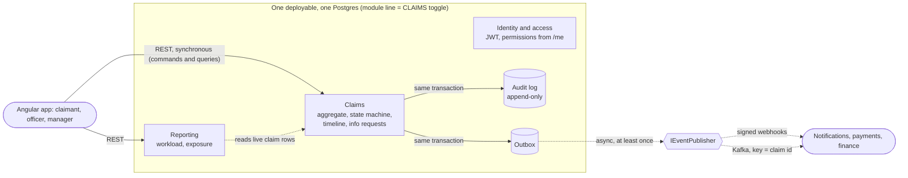
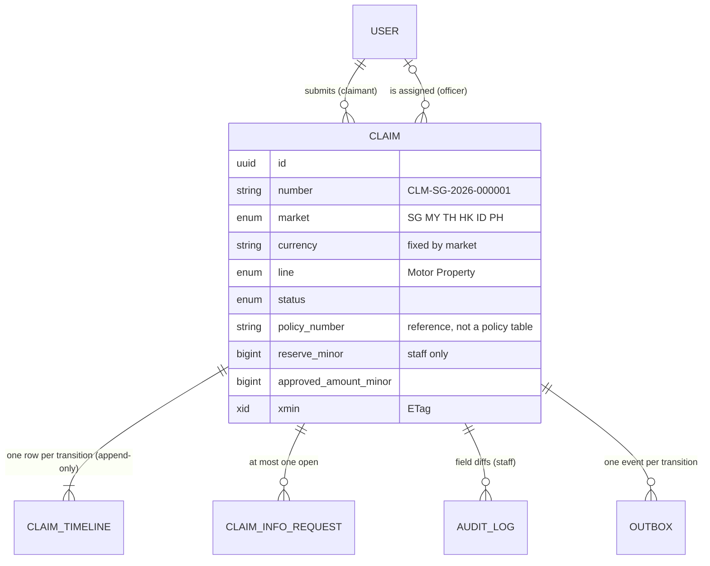
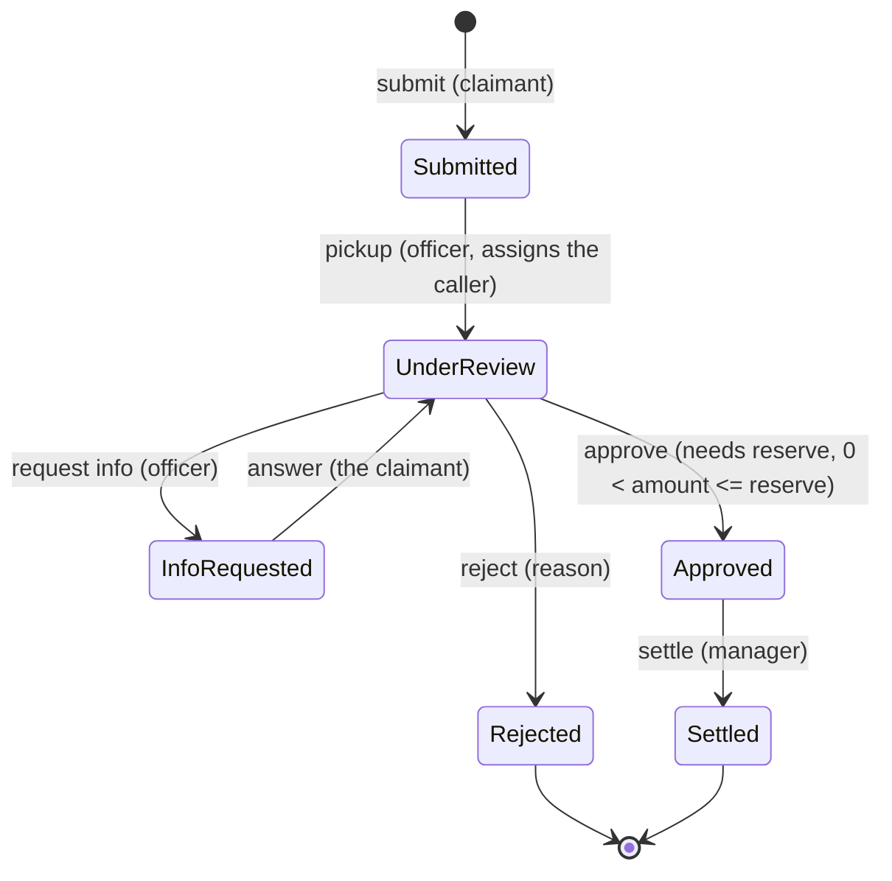

# Claims platform: what was built in the window, and why

The take-home brief: motor and property claims across six APAC markets, three audiences (claimants, claims staff, managers), one Angular app, and a defended choice between REST and Kafka. Everything below was built inside the timed window that starts at git tag `claims-window-start`; `git diff claims-window-start..HEAD` is the whole window. The scaffold under it (auth, audit, outbox, idempotency, the console shell) was built before the window and is disclosed as a starter (see the README).

Try it: `docs/runbooks/11-claims.md` (curl walk-through, every guard), `bruno/fugue/claims/`, the console (`docs/runbooks/09-console.md`). Plan and decisions: `docs/plans/claims-window.md` (decisions A to L), D-052, D-053, D-056.

## 1. Shape: one deployable, a claims module

A modular monolith (plan decision A). A claim's new state, its claimant-visible timeline row, its audit row and its outbox event must commit together or not at all; inside one process that is one database transaction. Splitting claims into its own service is a "with more time" item along the module line that already exists (`Features/Claims`, `Persistence/Claims`, the `CLAIMS` module toggle), and it would bring the outbox with it, not a distributed transaction.

### Service boundaries in one picture

Solid edges are synchronous; dotted edges are asynchronous. **The boundary is the transaction:** whatever must commit with a claim's state change (its timeline row, audit row and outbox event) lives with the claim; everything that only reacts to it is a consumer of events and can be split out without a distributed transaction.

| Would become a service | Order | What drives the split |
|---|---|---|
| Notifications (SMS, email on `claim.*`) | first | Already async; a different failure mode (a provider outage must never fail a claim). |
| Exposure and workload reporting | second | Read-only, different consumers (finance) and scale; becomes a projection fed by claim events (reserve changes are events too). |
| Payments and settlement | third | Talks to an external system; needs a saga and its own outbox. |
| Claims core with identity | stays | Claim state, timeline, audit and event must commit atomically: that transaction is the boundary. |

A separate team, a separate scaling or failure profile, or an external system drives a split; the number of nouns does not.

**The contract between frontend and backend is owned by the backend:** the OpenAPI document is generated from the controllers, pinned by a committed snapshot that a test regenerates (`docs/api/openapi.v1.json`, D-042, ADR-012), and the Angular client is generated from it (`npm run api:gen`). A contract change is a reviewable diff in one file.

| Layer | Where |
|---|---|
| Aggregate and state machine | `src/Fugue.Domain/Claims/Claim.cs` (+ `ClaimTimelineEntry`, `ClaimInfoRequest`, `ClaimEvents`, `Market`) |
| Use cases (one file per slice) | `src/Fugue.Application/Features/Claims/` (`Commands/`, `Queries/`, `ClaimFlow.cs` the shared command shape, `ClaimScope.cs` visibility) |
| Persistence and reports | `src/Fugue.Infrastructure/Persistence/Claims/` (`ClaimRepository`, `ClaimReports`), migration `AddClaims` |
| HTTP | `src/Fugue.Api/Controllers/ClaimsController.cs` (one-line actions), `Contracts/ClaimRequests.cs` |
| Seed | `src/Fugue.Infrastructure/Persistence/Seeding/ClaimSeeder.cs` (Development only) |

## 2. The claim and its state machine

A claim (`claims` table) has a number the claimant quotes (`CLM-<market>-<yyyy>-<seq>`, one global Postgres sequence plus a unique index), a market (SG, MY, TH, HK, ID, PH) whose currency is fixed (SGD, MYR, THB, HKD, IDR, PHP), a line (Motor, Property), the claimant who owns it, the assigned officer, the incident (policy number, date, description, location), and money: an internal reserve and an approved amount, both `bigint` minor units of the market's currency.

Policy, party and payment are deliberately references, not entities: the policy system owns cover (a real build validates the policy number against it at submit), and payments belong to the settlement consumer. Faking a policy table would add rows without adding a decision.

Every move is a method on the aggregate that returns a `Result`; an illegal move is 409 `claim.invalid_transition` and changes nothing. The reserve can be set while the claim is UnderReview or InfoRequested; approving without one is 409 `claim.reserve_required`; an amount outside `0 < amount <= reserve` is 400 `claim.amount_invalid`. The incident date may not be in the future or more than a year back, counted in the market's own calendar day (a Manila claimant at 07:00 local is still "yesterday" in UTC).

| Move | Permission | Who else is checked | Event |
|---|---|---|---|
| Submit | `CLAIMS_SUBMIT` | the claimant is the caller, never a body field | `claim.submitted.v1` |
| Pick up | `CLAIMS_HANDLE` | assigns the caller | `claim.assigned.v1` |
| Set reserve, request info, decide | `CLAIMS_HANDLE` | the assigned officer, or a caller who also holds `CLAIMS_SETTLE` (the manager override) | `claim.info.requested.v1`, `claim.decided.v1` |
| Answer a question | `CLAIMS_RESPOND` | the claim must be the caller's own, even for an admin | `claim.info.provided.v1` |
| Settle | `CLAIMS_SETTLE` | Approved only; no assignment check (settlement is a manager act) | `claim.settled.v1` |

At most one information request is open per claim: a partial unique index enforces it, so two officers asking at the same instant get one success and one 409, not two open questions.

## 3. Who sees what

| Audience | Role (seeded account) | Permissions |
|---|---|---|
| Claimant | `SELF_SERVICE` (`self@fugue.test`, `self2@fugue.test`) | `CLAIMS_SUBMIT`, `CLAIMS_READ`, `CLAIMS_RESPOND` |
| Claims officer | `STAFF` (`staff@fugue.test`, `support@fugue.test`) | `CLAIMS_READ`, `CLAIMS_ALL`, `CLAIMS_HANDLE`, `CLAIMS_WORKLOAD` |
| Manager | `MANAGER` (`manager@fugue.test`) | staff plus `CLAIMS_SETTLE`, `CLAIMS_EXPOSURE` |
| Admin | `ADMIN` (`admin@fugue.test`) | all |

- **A claimant sees only their own claims.** Every read, list page and command loads through one scope filter (`ClaimScope`); a claim outside it is 404 `claim.not_found`, indistinguishable from a claim that does not exist. A claimant calling a staff route gets 403 for lacking the permission, the same answer for every id, so it reveals nothing (D-056).
- **The reserve never reaches the claimant.** It is the insurer's internal estimate; for a claimant the API answers `reserveMinor: null` and `assignedOfficerId: null` (Bruno `claims/12` checks it).
- **The timeline is written for the claimant.** One append-only row per transition and per question and answer (`claim_timeline`, a trigger rejects UPDATE, DELETE and TRUNCATE). Staff actions read as "Claims team" to the claimant; officer names do not leave the building. The full field diff for staff lives in the audit log (`/audit?entityId=<claim id>`).
- Authorization is enforced once, at the HTTP edge (`[HasPermission]` on every action, pinned by an arch test); handlers use permissions only to scope data. A second transport, such as a Kafka consumer that dispatches commands, would need its own authorizer first (D-056).

## 4. Concurrency, duplicates and atomicity

- **Every command after submit needs `If-Match`** (the claim's `ETag`, Postgres `xmin`). Missing is 428 `claim.if_match_required`; stale is 412 `claim.version_mismatch`, checked BEFORE the state machine runs, so a stale caller is told to re-read rather than given a business error about a state they never saw. The save carries `WHERE xmin = @expected` as well, for a write that lands between load and save, and it runs even when nothing changed (Codex finding, D-056).
- **Submit requires an `Idempotency-Key`** (400 `idempotency.key_required` without one). A retried submit replays the first response (`Idempotent-Replayed: true`); the same key with a different body is 422. A duplicate claim is real harm, so on this route the key is not optional (ADR-013 amendment).
- **One transaction per move:** the claim row, the timeline row, the info request, the audit row (field diff) and the outbox event commit together.

## 5. REST or Kafka (the brief's question)

**Commands and queries are REST; every state change is also an event.**

- A claimant submitting, or an officer approving, needs the answer now: accepted, or 409 with the guard's reason, or 412 because someone else got there first. Over Kafka that becomes request/reply with correlation ids, reply topics and timeouts, and the user waits on a consumer group to learn that the reserve was missing. REST gives the guard's verdict in the same round trip, with standard semantics (ETag, Idempotency-Key, RFC 9457 problems) that the console and Bruno already speak.
- **Events go through the transactional outbox** (written in the same transaction as the state change, so no event is lost and none is sent for a rolled-back change) and are published today as signed webhooks. The broker seam is one interface, `IEventPublisher`: a Kafka adapter keys messages by `ClaimId` so each claim's events stay in order on one partition, and consumers dedupe on the event id (delivery is at least once).
- **What consumes the events:** claimant notifications (SMS, email), an exposure projection for finance, the payment run after settlement, fraud scoring, a data lake. None of them belongs inside the claimant's request, and each can fail or lag without failing the claim.
- **When Kafka would carry the intake as well:** high-volume first notice of loss from partner channels (dealers, telematics, brokers) where the sender does not wait for a human-facing answer. Then a consumer validates and calls the same application command, behind its own authorizer.

| Operation | How | Why |
|---|---|---|
| Submit, pick up, reserve, ask, answer, decide, settle | REST command, synchronous | The caller needs the guard's verdict now (201/200, 409 with the reason, 412 stale, 428, 400). |
| Queue, claim record, timeline, past questions, counts, workload, exposure | REST query, synchronous | Read your own write; keyset paging; as fresh as the last commit. |
| `claim.submitted/assigned/info.requested/info.provided/reserve.set/decided/settled.v1` | Outbox event, asynchronous, at least once | Other systems react (notify the claimant, project exposure, pay, score fraud); none of them may fail or slow the claim. |
| Partner or telematics intake at volume (not built) | Kafka in front of the same command | Nobody waits for a human answer; a consumer validates and calls the command behind its own authorizer. |

### The async nature of claims, across both tiers

- **Backend:** a claim moves when a person acts, days apart. Every move commits its state, timeline row, audit row and event together; consumers learn about it from the event, never by polling the database.
- **Frontend:** the claimant's and officer's screens refetch when the window regains focus and poll every 15 to 20 seconds while open, paused while a dialog is open so the record (and its ETag) does not change under a half-filled form. A stale action still gets the 412 banner, so nothing is overwritten silently.
- **With more time:** server-sent events to the browser, fed by the same outbox events (the events already exist; the push channel is the missing piece). SSE rather than websockets: one-way, plain HTTP, works through the existing auth and proxies.

## 6. Workload and exposure

- **Workload** (`GET /claims/workload`, `CLAIMS_WORKLOAD`): per officer, open claims by status, the age of the oldest open one, decisions in the last 7 and 30 days, and the median days from submit to decision over the last 30 days (`percentile_cont`); the unassigned count; open claims in age bands 0-2, 3-7, 8-14 and 15+ days.
- **Exposure** (`GET /claims/exposure`, `CLAIMS_EXPOSURE`): per market, line and currency, the open count, the outstanding reserve on open claims, and the approved-but-not-settled amount; totals per currency. **There is no grand total:** adding SGD to IDR is meaningless without a rate and a rate date, and choosing those is a finance decision, not a UI one.
- Both are plain SQL over live rows, so they are as fresh as the last commit. At scale they become projections fed by the claim events (the outbox already emits them).

## 7. Money

Minor units in a `bigint`, the currency fixed by the market, never a float, never summed across currencies. The API carries `amountMinor` plus the ISO 4217 code; the console formats with `Intl.NumberFormat` and the currency's minor digits.

## 8. Cut, and what comes with more time

Cut inside the window, in the plan's cut order: a settlement saga with payment failure and retry (Settle is a single move today); property-specific fields (sum insured, peril); attachments (photos, police report); manager drill-down from exposure to claims; market-scoped module toggles.

With more time: the event-fed exposure projection; a Kafka `IEventPublisher` adapter and a consumer-side authorizer; a payments service consuming `claim.settled.v1` with its own outbox; fraud and SLA rules as event consumers; property fields and attachments (object storage, virus scan); per-market business calendars for ageing; splitting claims into its own deployable along the module line.
