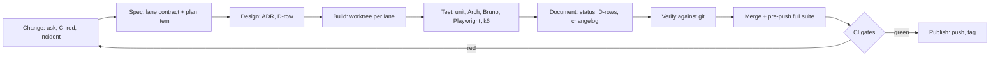

# Demo script (15 to 20 minutes)

The walkthrough order, one line to say at each step. Every ask in the brief is served by steps 4 to 13. Setup: `docker compose up -d --build` (runbook 00), a fresh seed, two browser windows side by side (claimant left, staff right) from step 4. Passwords: runbook 05. Add `?tour=off` to the first URL in each window so the reviewer tour does not start while presenting.

| # | Min | Screen or doc | Say |
|---|---|---|---|
| 1 | 0:00 | `README.md`, the disclosure | "The starter was built before the window and disclosed; everything after the `claims-window-start` tag is the timed build, one `git diff`." |
| 2 | 1:00 | `docs/CLAIMS.md` section 1, the service-boundaries picture | "One deployable with a claims module. The boundary is the transaction: state, timeline, audit and event commit together. Solid edges are synchronous, dotted are events; notifications split out first." |
| 3 | 2:30 | `docs/CLAIMS.md` section 2 (state machine, entities) and section 5 (sync/async table) | "Commands are REST because the caller needs the guard's verdict now; every transition is also an event through the outbox, and that is where Kafka plugs in." |
| 4 | 4:00 | Claimant `self@fugue.test`: the landing, "We need one answer from you" | "A claimant lands on the one thing that needs them. Staff names and the reserve never reach this view." |
| 5 | 5:00 | Claimant: answer the question; the claim track on the banner moves | "Answering is a guarded command on their own claim only; another claimant probing it gets 404, not 403." |
| 6 | 6:00 | Claimant: Report an incident | "Submit requires an Idempotency-Key; a retry replays the first response, because a duplicate claim is real harm." |
| 7 | 7:00 | Officer `staff@fugue.test`: My work, "Pick up next" | "Same Angular app, different landing: navigation and buttons come from permission codes on `/me`, never role names." |
| 8 | 8:00 | Officer: the claim record. The next-step card says "Blocked: set a reserve"; set it; "Ready"; approve | "The card mirrors the aggregate's guards and the API still enforces them; approval cannot exceed the reserve." |
| 9 | 9:30 | The claimant window, untouched: the status changes on its own | "The async side on the frontend: refetch on focus and polling today; server-sent events fed by the same outbox events with more time." |
| 10 | 10:30 | Manager `manager@fugue.test` acts on a claim the officer just changed: the 412 banner | "ETag and If-Match on every command; stale is checked before the state machine, so you are told to re-read." |
| 11 | 11:30 | Manager: Team and exposure; settle from "To settle" | "Exposure is reserve on open claims plus approved-not-settled, per currency. No grand total: SGD plus IDR needs a rate and a rate date, a finance decision." |
| 12 | 13:00 | Same page: "unreserved" counts | "An open claim with no reserve is unknown exposure, so the page counts it instead of showing zero." |
| 13 | 14:00 | Admin `admin@fugue.test`: the claim's audit history, then Webhooks, the dev sink tab with `claim.*` events | "Three records, three audiences: the timeline for the claimant, the audit diff for admins, events for other systems, all in one transaction." |
| 14 | 15:30 | `docs/ai-journal.md`: the 17:20, 17:50 and 18:00 entries | "The journal records where a check contradicted an agent's report, and what I overrode. A review is evidence, not a verdict." |
| 15 | 17:00 | The software factory: `docs/ai/briefs/fleet-2026-11-28/` (a lane contract), `docs/branch-ledger.md`, `.github/workflows/ci.yml`, then the two fix lanes below | "The product is the claims platform; the second product is the factory that built it. Today it caught its own failures: CI's Bruno run went red on a sign-in limit, and a stalled Kafka test blocked the push. Each became a fix lane with a contract and was verified against git before merge." |
| 16 | 19:00 | `docs/CLAIMS.md` section 8 | "What I cut, in the order I cut it, and what comes next." |

## Software factory (step 15)

The loop that built Fugue, each stage pointing at a real artifact in this repo (D-066):

1. **A change arrives**: an owner ask, a CI red or an incident (`docs/failure-modes.md`).
2. **Spec**: a lane contract (objective, owned files, acceptance, stop conditions), archived in `docs/ai/briefs/fleet-2026-11-28/`, plus a plan item in `docs/plans/overnight-2026-11-28.md`.
3. **Design where needed**: `docs/adr/`, `docs/design/`, D-rows in `docs/decisions.md`.
4. **Build in a sandbox**: one git worktree and branch per lane (`docs/branch-ledger.md`), the model routed per lane (Opus for API, migrations and security; Sonnet for UI); a dispatcher writes contracts, lanes build, one integrator merges.
5. **Iterate and test**: unit tests, the 37 ArchTests, the Bruno API contract (`bruno/fugue`), headless Playwright with zero console errors, k6 load (`load/`), Stryker mutation (`tests/Fugue.MutationTests`). Guardrails: the lefthook commit gates (`refs-trailer` resolves every `Refs:` id, `fix-has-test`, `secrets-scan`, `test-integrity`), a file lock that serializes the full .NET suite, and failure mode 36 (a sleeping host stalls Testcontainers).
6. **Document as part of the change**: lane status files (`docs/ai/lanes/`), D-rows, `CHANGELOG.md`, `docs/hot-state.md`, `docs/traceability.md` regenerated from commit trailers.
7. **Verify against git, never against an agent's report**: the head sha and a diff that stays inside the lane's owned files.
8. **Merge**: the integrator merges with `--no-ff`, rebuilds the demo stack, and pushes behind the pre-push full suite.
9. **CI gates**: `.github/workflows/ci.yml` jobs `backend`, `scripts`, `web` and `api-contract` (Bruno against the compose stack). A failure loops back to 1 as a new fix lane; a pass publishes (push, tag).

Two live examples from 2026-11-28:
- **nth-brunoci**: the owner pasted a red CI `api-contract` run (115 of 127 requests passed: the collection signed in more often than the 20-per-minute limiter allows, then got 401s). A fix lane made the collection sign in once per account per run with the limiter still on; 127 of 127 passed on the demo stack; merged in 766ff6f.
- **nth-kafkafix**: the refactor lane's base check found that the Kafka "no broker" test relays every leftover outbox row to a dead address, stalling or crashing a full run; a tests-only fix lane took it as the critical path for the push.

## Keep in the product, off the screen (unless asked)
Customers (the starter's sample), webhook subscription management, groups and overrides and the roles matrix, audit search, the reserve sheet and SLA calendar, the reviewer tour, mutation/pairwise/load reports, module toggles (20 seconds, only if "is it really modular?" comes up), runbooks.
