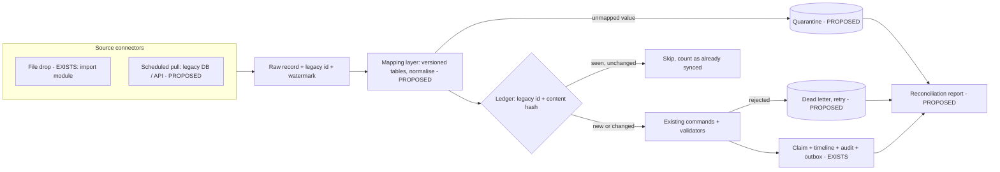

# Legacy Sync: an anti-corruption adapter over the import module

Status: PROPOSAL (design only). Nothing in sections 3 to 8 is built. Section 1 says exactly what exists today.
Origin: owner ask, 2026-11-28 11:30: a way to bring existing legacy data in so the platform is backward compatible, with the import module as the central adapter.

## 1. What exists today (built, merged)

| Piece | Where | What it really does |
|---|---|---|
| File import, three sources | `src/Fugue.Application/Features/Import/` | Staff upload .csv/.xlsx, .eml/.mbox or a WhatsApp .txt; the server parses it into drafts (`Parsing/`). D-074: files stand in for Graph / Gmail / WhatsApp connectors; no external service is called. |
| Review before create | `Queries/CheckImportDrafts.cs`, `Commands/CreateImportedClaim.cs` | A person reviews each draft; the create runs the SAME `SubmitClaimValidator` (via `ImportRules`), the same `Claim.Submit`, the same insert: timeline, audit row, outbox `claim.submitted`. |
| Idempotency ledger | `claim_imports` (migration `20261127194749_AddClaimImports`), `Sql/import/insert.sql` | Primary key = server SHA-256 of the source item (spreadsheet row, Message-Id, chat message). Inserted `ON CONFLICT DO NOTHING` in the claim's transaction; a repeat is 409 `import.already_imported`. |
| Domain to market routing | `Import:MarketByDomain` in `src/Fugue.Api/appsettings.json`, `IImportSettings` | Config table, longest-suffix match. |
| Outbox, retry, dead letter | ADR-011 | `outbox_messages` in the same transaction; backoff with jitter; `dead` after `MaxAttempts`; `POST /webhooks/deliveries/{id}/redeliver`. |
| Idempotency keys | ADR-013 | Header-based, for HTTP creates; the import deliberately uses the ledger instead (D-074). |

Not built: any scheduled pull, any legacy DB or API connector, any versioned mapping table, customer import, a reconciliation report, a watermark, an import dead-letter. The import creates claims only, owned by an existing user account (it refuses when there is none).

## 2. Goal and principle

Legacy systems keep their own ids, vocabularies and quality. Fugue must not bend its domain to them. Legacy Sync is an anti-corruption layer (ACL): everything legacy-shaped stops at the adapter; everything past it is a normal Fugue command.

Dogfooding rule: a synced record enters through the same Mediator command, validator, repository, audit row and outbox event the console uses. No back-door SQL into `claims`. The adapter is a client of the application layer, never of the tables (the only table it owns is its own ledger).

## 3. Shape

## 4. Source connectors

Both emit one neutral record: `{ source, legacyId, payload, observedAt }`.
* File drop: exists. Today its key is a content hash because a spreadsheet row or chat message has no stable id; a legacy export that does carry an id should use that id as the key (see section 6).
* Scheduled pull: proposed. A `BackgroundService` shaped like the outbox dispatcher (ADR-011: `FOR UPDATE SKIP LOCKED` lease so two instances never pull the same batch), reading a read-only legacy connection or API with credentials from configuration, never from request data. Per D-074 this needs tenant consent and secrets we do not have today, which is why it is a proposal.

## 5. Mapping layer

* Legacy fields to Fugue claim (and, later, customer) fields live in versioned mapping tables: `mapping_version`, `source_system`, `field`, `legacy_value`, `fugue_value`, `valid_from`. Each synced record stores the version it was mapped with, so a corrected mapping can be re-applied deliberately.
* Reuse, do not duplicate: market and line-of-cover normalisation is `ImportRules` today (`ParseMarket`, `ParseLine`, `ParseDate`); domain to market is `Import:MarketByDomain`. The proposal moves those from code and config into data per source system, with the same behaviour as the default version.
* Unmapped values are never guessed. A record with an unknown market, line or claimant goes to quarantine with the offending field and value, and appears in the report. Adding a mapping row releases the quarantined records for the next run.

## 6. Idempotent upserts keyed by legacy id

Extend the `claim_imports` idea to a ledger keyed `(source_system, legacy_id)` holding `content_hash`, `claim_id`, `mapping_version`, `first_synced_at`, `last_synced_at`.
* New legacy id: create through the import command path (as `CreateImportedClaim` does now).
* Same id, same hash: skip. Same id, changed hash: today a claim has a workflow and an ETag; blindly overwriting a claim that staff have since worked on would be wrong. Proposed default: legacy changes to an already-synced claim are recorded as a timeline note plus a report line (a mismatch), not applied. Applying specific fields is a later, explicit per-field policy.
* The insert stays `ON CONFLICT DO NOTHING` in the claim's transaction, so concurrent runs cannot double-create (this is the property `ImportApiTests` pins today for four concurrent creates).
* Rolling the ledger back loses the "already imported" memory (migration catalog row 13); the new ledger needs its own rollback test and catalog row.

## 7. Backfill, incremental, failure, reconciliation

* Backfill: a one-off run over a bounded window or file set, rate-limited, safe to re-run because of section 6. Incremental: a stored watermark per source (`max(legacy_updated_at)` or a legacy sequence), advanced only after the batch commits; overlap by a small margin and rely on the ledger to dedupe.
* Failure: a record that fails validation or the command goes to a per-record dead letter with the reason, attempt count and backoff, retried like webhook deliveries (ADR-011) and revivable by an operator action analogous to `redeliver`. A bad record never blocks the batch; a connector outage retries the whole pull with backoff.
* Reconciliation report per run: legacy count read, created, skipped (unchanged), quarantined, dead-lettered, and a mismatch list (changed in legacy since sync). Invariant to display: read = created + skipped + quarantined + dead-lettered. Counts come from the ledger and queues, not from logs.

## 8. Build order if funded

1. Reconciliation counts over the existing ledger and file import (smallest, uses what exists).
2. Legacy-id keyed ledger and mapping tables behind the file drop.
3. Quarantine and dead letter with an operator screen.
4. Scheduled pull connector and watermark.

## 9. Scaling to many users and offline sync (PROPOSAL, nothing here is built)

Each point names the mechanism that already exists in Fugue and what a scaled version would add.
- **Offline queue on the client.** A field or call-centre client keeps an outbox of pending commands, each with an `Idempotency-Key` (ADR-013). Replaying the queue after a reconnect is safe because the API already answers a repeated key with the stored response instead of a second claim.
- **Conflicts are detected, never overwritten silently.** Every mutable aggregate carries Postgres `xmin` as its ETag and updates need `If-Match` (ADR-006): a stale offline edit gets `412`, the client shows both versions and a person chooses. Last-writer detection, not last-writer-wins.
- **Incremental pull with watermarks.** The search indexers already page by an `(updated_at, id)` cursor; the same watermark, returned as a sync token, lets a client ask only for what changed since its last pull.
- **Fan-out through the server outbox.** Domain events are written in the same transaction as the change (ADR-011) and delivered to any number of signed-webhook consumers with retry and dead letters, so new consumers (mobile push, a data warehouse, the legacy system itself) subscribe without touching the write path.
- **Read scaling.** Search already runs on Meilisearch (D-063, D-072), off the primary; hot reads such as the permission lookup on `/me` are the HybridCache candidate (item 27, W-041), with stampede protection.
- **Partitioning by market or tenant.** The schema already carries the tenancy toggle (ADR-001, ADR-003); a scaled deployment partitions by market or tenant first, because claims never cross markets.

Interview: "Offline clients queue commands with idempotency keys, so a retry never doubles a claim. Conflicts surface as 412 through the xmin ETag, so nobody's edit is lost silently. Everything downstream hangs off the transactional outbox and cursor watermarks we already run, so scaling out adds consumers and partitions, not a new write path."

## Interview answer in 3 sentences

Legacy compatibility is an anti-corruption layer built on our import module: connectors (a file drop today, a scheduled pull next) emit neutral records, a versioned mapping layer normalises them and quarantines anything unmapped, and an idempotent ledger keyed by legacy id decides create, skip or report. Every synced record goes through the same commands, validators, audit and outbox as the console, so there is no back door, and failures dead-letter and retry the way our webhook deliveries do. Today only the file import, its hash ledger and the domain-to-market config exist; the pull connector, mapping tables, watermark and reconciliation report are a proposal, and I would build the reconciliation counts first.
