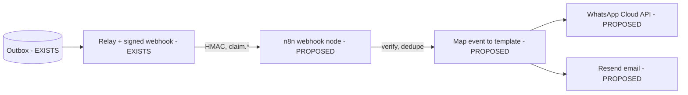
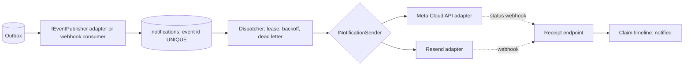

# Notifications, attachments and the settlement saga

Status: DESIGN ONLY, not built (KIV). Nothing in sections 3 to 8 exists in the repo. Section 1 says exactly what exists today.
Origin: owner ask, 2026-11-28 13:41: explain how the "Not built" row on the explained page ("Notifications to the claimant outside the app; attachments; a settlement saga with payment retries") would be built: start with an n8n MVP, then our own hosted worker with a Meta WhatsApp number and an email sender on the Resend API.

## 1. What exists today (built, merged)

| Piece | Where | What it really does |
|---|---|---|
| Claim events | `docs/CLAIMS.md` (events table); `claim.submitted`, `claim.assigned`, `claim.info.requested`, `claim.info.provided`, `claim.reserve.set`, `claim.decided`, `claim.settled`, all `.v1` | Each claim transition writes an outbox row in the SAME transaction as the state change, the timeline row and the audit row. The event is thin and masked; receivers fetch by id. |
| Outbox and relay | ADR-011; `src/Fugue.Infrastructure/Webhooks/OutboxDispatcher.cs`, `OutboxDispatcherService.cs` | A `BackgroundService` claims rows with `FOR UPDATE SKIP LOCKED`, hands each to `IEventPublisher`, marks it dispatched. Exponential backoff with jitter, `dead` after `MaxAttempts`, revivable by `POST /webhooks/deliveries/{id}/redeliver`. The outbox is the single retry authority. |
| Signed webhooks | `WebhookSender.cs`, `WebhookEnvelope.cs`, `WebhookFanOutPublisher.cs` | One `webhook_deliveries` row per matching active subscription. Headers `X-Fugue-Signature: v1=<HMAC-SHA256(secret, timestamp.body)>`, `X-Fugue-Event-Id`, `X-Fugue-Event-Type`, `X-Fugue-Timestamp`. At least once; receivers verify, reject timestamps older than 5 minutes and dedupe on the event id. |
| Per-receiver resilience | ADR-011 "Resilience"; `GuardedConnect.cs`, `NetworkGuard.cs`, `WebhookUrlGuard.cs` | A circuit breaker, timeouts and a rate limiter per receiver authority; https only and SSRF guards (private and metadata ranges refused). |
| Subscription API | `src/Fugue.Api/Controllers/WebhooksController.cs` (`subscriptions`, `rotate-secret`, `deliveries`, `redeliver`); `WebhookSubscriptionStore.cs` | Admin-only CRUD with event-type filters (`claim.*`, `*`, exact). The secret is `whsec_` plus 32 random bytes, shown once on create and on rotate, stored encrypted (`DataProtectionSecretProtector.cs`). |
| Dev sink | `DevWebhookSink.cs`, `src/Fugue.Api/Controllers/DevWebhookSinkController.cs` | Development only: verifies the signature, dedupes by event id, keeps the last 50. It proves the contract; it sends nothing to a claimant. |
| Event port | `src/Fugue.Application/Abstractions/MessagingPorts.cs` (`IEventPublisher`); `src/Fugue.Infrastructure/Messaging/KafkaEventPublisher.cs` | Webhook fan-out is the first adapter; a Kafka adapter exists, off by default (`Events:Publisher`). |
| Claimant privacy rules | `docs/CLAIMS.md` lines 116 and 117 | The reserve never reaches the claimant; staff actions read as "Claims team"; officer names do not leave the building. |
| Settlement letter | `src/Fugue.Application/Features/Letters/` | A PDF a person downloads in the app. Nothing is sent to anyone. |

Not built: any consumer of those events, any message to a claimant outside the app, any consent or channel-preference store, any template registry, any attachment storage, any payment provider or payment state. `claim.settled.v1` today only means a manager marked an Approved claim settled; no money moves (`docs/CLAIMS.md`, "With more time").

## 2. Goal and principle

Tell a claimant what happened to their claim on the channel they chose, and later move money and accept documents, without touching the claim write path. The claim aggregate and its transaction stay as they are. Every new capability is a CONSUMER of the outbox events (the event port exists for exactly this) or a new command that raises its own events through the same outbox.

## 3. Phase 0: an n8n MVP, no Fugue code change

* Create one subscription through the existing API (filter `claim.*`); give n8n the `whsec_` secret. n8n verifies `X-Fugue-Signature` and the timestamp in a code node, dedupes on `X-Fugue-Event-Id`, fetches the claim by id for the claimant's contact and market, picks a template, sends.
* WhatsApp: the Meta WhatsApp Cloud API with a business number. Business-initiated messages outside the 24-hour customer-service window must use a pre-approved message template; inside the window free-form replies are allowed. Template approval takes time, so submit the first few (received, more information needed, decision, settled) on day one.
* Email: the Resend API for transactional mail from a verified sending domain.
* Why start here: it proves which messages claimants actually want, and in which channel, in days, with no deploy of ours.
* Risks, stated plainly: n8n is a single point (if it is down, the relay retries with backoff and then dead-letters, which is recoverable by `redeliver`, but nothing is sent meanwhile); the Meta token and Resend key live in n8n's credential store; there is no consent store, so the MVP may only message people who gave their number and an explicit opt-in on the claim, and must honour a "stop" reply by hand; delivery status is not written back to the claim timeline; the public webhook URL must be https (the SSRF guard refuses anything else).
* Exit criteria to move on: a message set that people use, a measured delivery rate, and the first wish for consent per claimant or per-market language that n8n flows handle badly.

## 4. Phase 1: our own notifications worker

* Where it runs: a hosted worker in the same deployable first (a `BackgroundService` shaped like the outbox dispatcher), split into its own service later along the module line, as `docs/CLAIMS.md` already describes for a payments service. It receives the same events, either as a second `IEventPublisher` adapter or as a signed-webhook consumer; both are at least once, so it dedupes.
* Idempotency: a `notifications` table with a unique key on `(event_id, channel)`. A redelivered event inserts nothing the second time (`ON CONFLICT DO NOTHING`, the same pattern as `webhook_deliveries`).
* Consent and preference per claimant: opt-in recorded with time and source, channel choice (WhatsApp, email, none), quiet hours in the market's own time zone, language per market (six markets, `docs/CLAIMS.md`). No row, no message.
* Template registry per market and language, versioned; WhatsApp templates carry the Meta approval state, and the worker refuses to send an unapproved one.
* Sending: one `INotificationSender` port, two adapters (Meta Cloud API, Resend). Retries and dead letter mirror ADR-011: lease claim, backoff with jitter, dead after `MaxAttempts`, an operator redeliver. The provider's own retry is off; our table is the single retry authority.
* Delivery receipts: WhatsApp status webhooks and Resend webhooks hit a signed endpoint, update the `notifications` row (sent, delivered, read, failed) and append a "notified" line to the claim timeline, which is already append-only and claimant-readable.
* PII rule: a message is built from the same claimant-safe view the API serves to the claimant. No reserve, no officer name, "Claims team" as the sender; the claim number and a link to sign in are the payload. The event is thin, so the worker reads claimant-visible fields, never the staff view.
* "Blast", meaning bulk sends, is a separate, narrow thing: only to opted-in people, only with an approved template, rate-limited to the account's messaging tier, and never carrying claim data (for example a maintenance notice or a satisfaction survey). Claim updates are one-to-one events, not blasts.

## 5. Attachments (short)

A claimant or officer uploads evidence (photos, a repair quote). Flow: the API issues a short-lived pre-signed upload URL for object storage (S3, or MinIO in compose); the client uploads directly; a virus scan runs before the file is marked available; a metadata row (claim id, uploader, content type, size, hash, scan status) is written through a command that also writes timeline, audit and outbox like any other transition. Scope is the claim's scope: whoever may read the claim may read its attachments, and the same market and claimant rules apply. Limits are config: an allowlist of types (images, PDF), a size cap, a count cap per claim. Nothing is stored in the database but the metadata.

## 6. Settlement saga (short)

Today `Settled` is a status. A real settlement is a process:

`Approved -> PaymentRequested -> Paid | PaymentFailed`

* A payment-provider adapter behind a port (the provider is a decision, not made here). A payment is created from `claim.settled`-style intent with an idempotency key per payment (the claim id plus a payment sequence), the same discipline as ADR-013.
* Each step is a claim event written through the outbox in the same transaction as its state change, so the notification worker of section 4 tells the claimant "payment sent" with no extra wiring.
* Retries with backoff on provider errors, dead letter and an operator revive, as in ADR-011. A provider callback is verified and deduped like any webhook.
* Compensation: on a final failure the claim returns to Approved and a staff task is created; money is never assumed moved without a provider confirmation. A reconciliation between our payment rows and the provider's report is the control, not the saga itself.
* Money rules carry over: minor units, the market's currency, no cross-currency totals (`docs/CLAIMS.md`, exposure).

## 7. Decisions

| Question | Choice | Why | Alternative |
|---|---|---|---|
| n8n first or build first | n8n first, for days | Learn which messages matter before owning consent, templates and receipts. Costs no Fugue change. | Build first: right if consent and audit are needed on day one. |
| WhatsApp access | Meta WhatsApp Cloud API directly | No middleman margin, we own the number and templates. | A business solution provider (faster onboarding, support, an extra bill) or Twilio (one API for SMS and WhatsApp, extra per-message fee). Check current pricing and onboarding terms for each. |
| Email | Resend | Simple API, webhooks for delivery events. | Amazon SES (cheaper at volume, more setup). Check current pricing and limits. |
| Where the worker lives | Same deployable first | One transaction boundary, one deploy. | Own service once volume or ownership demands it. |
| Event source | Outbox via the existing port | Atomic with the claim, already retried. | Polling the claims table: no. |
| Retry authority | Our table, provider retries off | One place to see and revive failures. | Provider retry: invisible. |

Costs and limits: WhatsApp conversation or message pricing, template approval rules, per-number messaging tiers, Resend and SES prices and sending limits, and object storage costs all change; for each, "check current pricing". None is stated here on purpose.

## 8. Risks, and what we would measure

* Risks: template rejection or delay; a quality rating drop that lowers the number's tier; sending to someone who has not opted in (a legal and a platform risk); PII leaking into a message (guarded by building from the claimant view and a test that asserts no reserve or officer name); a provider outage (retries and dead letter, no effect on claims); duplicate sends (event id unique key).
* Measure: delivery rate per channel and market, time from event to provider ack, dead-letter count and age, opt-out rate, and per message type the share of claimants who then open the claim (does the message help).

## 9. Build order if funded

1. n8n MVP on one market and the four core templates (section 3).
2. Consent store and the `notifications` table, Resend first (no template approval wait), then Meta.
3. Receipts into the timeline, operator screen for dead letters.
4. Attachments (section 5).
5. Settlement saga behind a provider adapter (section 6).

## Interview answer in 3 sentences

Today every claim transition already writes a thin, masked event to a transactional outbox, and a relay delivers it as an HMAC-signed webhook with retries, circuit breakers and a dead letter, so a notification service is just another consumer and never touches the claim write path. I would start with an n8n flow subscribed through the existing subscription API, sending WhatsApp templates through the Meta Cloud API and email through Resend, to learn which messages claimants want, then replace it with our own worker that has a consent store, a per-market template registry, an idempotent `notifications` table keyed by event id, and delivery receipts written back to the claim timeline. None of it is built: only the events, the relay and the signed webhooks exist, and attachments and the payment saga follow the same outbox pattern.
