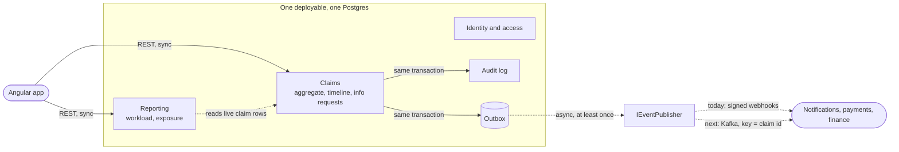

# Fable review: interview readiness, 2026-11-27

An independent read-only review by a different model tier (Fable), commissioned by the lead after the owner said the app "feels incomplete". Lead verification of its factual claims and the disposition are in the journal (2026-11-27 18:50) and D-061. Section 6 (prepared answers to panel probes) is kept out of the repo.

Read-only review. Every claim below was checked against the code or a screenshot; paths are relative to the repo root. I did not drive the live app (both :8080 and :5081/swagger answer 200); UI findings come from `web/docs/screenshots/claims-*.png` and the component sources.

**Verdict in three lines.** The backend answers the brief well and is defensible line by line (state machine, scope filter, ETag, required idempotency key, one-transaction outbox). The weak side is everything the panel *sees in the first five minutes*: no picture of the service boundaries, the event-driven half is invisible in the demo, the claimant never sees a change unless they navigate, and no screen tells any persona what to do next. Fix those four and the walkthrough lands; the nice-to-have libraries do not move the score and two of them invite a "why did you build this?" question.

A sixth lane, `nth-claimui` (`docs/ai/briefs/nice-to-haves.md:58-66`), already owns the banner, next-step card, merged team page and landings. It has no commits yet. Sections 3 and 4 refine that brief; they do not duplicate it.

---

## 1. Brief coverage matrix

| # | Ask or question in the brief | Where it is answered today | Strength | Gap, in one line |
|---|---|---|---|---|
| 1 | Claimant: report an incident | `web/src/app/features/claims/report-page.ts`; `POST /claims` with required `Idempotency-Key` (`ClaimsController.cs:23-31`) | strong | None for the demo; property-specific fields are a declared cut. |
| 2 | Claimant: track their claim | `my-claims-page.ts`, `claim-detail-page.ts` (plain-language `WHAT_NEXT`, timeline); `GET /claims/{id}/timeline` | adequate | The view only refreshes on open: `refetchOnWindowFocus: false` and no interval (`claim-detail-page.ts:279-280`, `core/query/query-client.ts:44`). "No visibility while waiting" is the brief's first complaint. |
| 3 | Claimant: provide information when asked | Answer panel in `claim-detail-page.ts`; `POST /claims/{id}/info-requests/{requestId}/response`, own scope even for admin (`ClaimScope.Own`) | adequate | The seeded question asks to "upload photos" (`ClaimSeeder.cs:142`) and the UI has a textarea only. It will be noticed in the demo. |
| 4 | Claimant: receive decisions | Decision reason and approved amount on the record; timeline note "Your claim has been approved. <reason>" (`Claim.cs:231,243`) | adequate | In-app only, pull only. Notification is "a consumer of `claim.decided.v1`" in the doc, nothing shows it. |
| 5 | Staff: pick up incoming claims | Queue with KPI strip, tabs, filters (`claims-queue-page.ts`); `POST /claims/{id}/pickup` | adequate | The default tab is "All", oldest first, so closed claims lead the list (`claims-queue.png`: Settled 40 d, Rejected 33 d on top). |
| 6 | Staff: review and assess | Reserve, request info, approve or reject dialogs (`claim-action-dialog.ts`), guards in `Claim.cs` | strong backend, weak UI | Five equal buttons in the header; a claim assigned to someone else shows no buttons and no reason (`claims-staff-detail.png`). |
| 7 | Staff: progress to settlement or rejection | `POST /claims/{id}/decision`, `POST /claims/{id}/settle` (manager) | strong | No payment step; settle is one move (declared cut). |
| 8 | Staff: team workload and performance | `GET /claims/workload` (`ClaimReports.cs`, `Sql/claims/workload-by-officer.sql`); `workload-page.ts` | weak | Read-only table, no links, no thresholds, no action. Officers with no claims are missing (the SQL starts `FROM claims JOIN users`), so spare capacity is invisible. |
| 9 | Managers: real-time outstanding claims and liability exposure | `GET /claims/exposure`; `exposure-page.ts` | adequate data, weak reading | Open claims without a reserve count as 0.00: Singapore shows 4 open claims and `SGD 0.00` (`claims-exposure.png`). That is unknown exposure shown as none. |
| 10 | Both user types in one Angular app | Permission-driven nav and guards from `/me` (`features/shell/nav.ts`, `app.routes.ts`, D-044); one detail page with `isStaff()` | strong | Landing is "first nav item you may open" (`app.routes.ts:8-18`), not a page built for the persona. Claimants also see a "Customers" nav item from the starter. |
| 11 | Backend first, explain the time split | README disclosure, `claims-window-start` tag, plan cut lines (`docs/plans/claims-window.md`) | strong | No end tag. The nice-to-haves wave weakens the "prioritise ruthlessly" story unless it is framed (section 6). |
| 12 | Q: core entities and relations | Prose in `docs/CLAIMS.md` §2; `Claim`, `ClaimTimelineEntry`, `ClaimInfoRequest` | adequate | No entity diagram. Policy is a free-text number; no Policy, Party, Payment or Document entity and no sentence saying why. |
| 13 | Q: one service or more, and what drives it | `docs/CLAIMS.md` §1 (one paragraph), plan decision A, README "with more time" | weak for a headline question | See "Service boundaries" below. |
| 14 | Q: synchronous vs event-driven | `docs/CLAIMS.md` §5, D-040, ADR-011 | strong reasoning, weak evidence | No table of operations; no claim event is visible anywhere in the demo; no broker runs. |
| 15 | Q: two user types from one codebase | As row 10; ARCHITECTURE §13 points 7 | strong | Say "permission codes, never role names" out loud; it is the answer. |
| 16 | Q: the contract, and who defines it | D-042, ADR-012: backend-owned OpenAPI snapshot, test-gated, generated client | strong | Not mentioned in `docs/CLAIMS.md`; one line there would let the panel find it. |
| 17 | Q: async nature of claims across both tiers | Backend: outbox per transition. Frontend: nothing beyond refetch on open | weak | The most direct gap against a named question. Needs a small code change and a doc section. |
| 18 | Q: what an officer needs to manage workload | Queue filters "Assigned to me / Unassigned"; workload table | weak | No "my work" view, no SLA signal, no next action. Owner feedback says the same. |
| 19 | Q: what the system must know about exposure | `ClaimReportDtos.cs` doc comment: reserve on open claims, approved-not-settled, per currency, never summed | strong reasoning | Unreserved open claims are not counted; a reserve change emits no event (`Claim.cs:196-210`), so the "event-fed projection" in the README could not be built from today's events. |
| 20 | Deliverable: meaningful commit history | 171 commits, Conventional Commits, `--no-ff` merge of the window | strong | None. |
| 21 | Deliverable: starts locally | README quickstart, Docker only, runbook 00 | strong | None. |
| 22 | Deliverable: AI working journal | `docs/ai-journal.md` (asked, proposed, decision, why), `docs/reviews/codex/2026-11-27-claims-seam.md` | strong | It is long. Pick three entries to show (section 2). |
| 23 | REST and Kafka: "you decide what uses which" | `docs/CLAIMS.md` §5; `IEventPublisher` seam, webhook adapter only | adequate | Zero Kafka in the stack (`docker-compose.yml` has none). The answer is sound but purely verbal. |

### Service boundaries: is the answer visible and demoable?

**Visible: no.** The decision exists in three places as a sentence (`docs/CLAIMS.md` §1, plan decision A, D-053) and nowhere as a picture. `docs/ARCHITECTURE.md` actively contradicts it: line 3 says the API has "no business domain on purpose" and line 5 says "the only sample aggregate is `Customer`". A panellist who opens ARCHITECTURE first will think the claims platform is an afterthought.

**Demoable: partly, and nobody would know.** Two real proofs exist and are not in any script:
- The module line is real: `[Module(ModuleCodes.Claims)]` on `ClaimsController.cs:20` and a runtime module toggle (D-023). Switching CLAIMS off as admin makes the routes and the nav vanish.
- The async edge is real: every transition writes an outbox row in the same transaction, and the Webhooks screen has a live sink tab (`features/webhooks/sink-tab.ts`, 1.5 s polling). But no subscription for `claim.*` is seeded (runbook 07 only subscribes `customer.*`), so the sink stays empty during a claims demo.

**The artefact that lands it in 60 seconds:** one context diagram at the top of `docs/CLAIMS.md` §1, with one table under it.

| Would become a service | Order | Why this one, why then |
|---|---|---|
| Notifications (SMS, email on `claim.*`) | first | Already async, no shared transaction, different failure mode (a provider outage must not fail a claim). |
| Exposure and workload reporting | second | Read-only, different consumers (finance), different scale; becomes a projection fed by events once reserve changes are events too. |
| Payments and settlement | third | Talks to an external system, needs a saga and its own outbox. |
| Claims core with identity | last | Claim state, timeline row, audit row and outbox row must commit together; that transaction is the boundary. |

Say what drives the split: a separate team, a separate scaling or failure profile, or an external system. Not the number of nouns.

---

## 2. The 15 to 20 minute demo

Two browser windows side by side (claimant left, staff right) from step 4 on. Rehearse with the stack freshly seeded. Before the session: sign in as admin and create one webhook subscription for `claim.*` to the dev sink (or seed it, change 4).

| # | Min | Screen or doc | Say (one line) |
|---|---|---|---|
| 1 | 0:00 | `README.md` lines 7-11 | "The starter was built before the window and disclosed; everything after the `claims-window-start` tag is the timed build, one `git diff`." |
| 2 | 1:00 | `docs/CLAIMS.md` §1, the new context diagram | "One deployable, a claims module. The boundary is the transaction: state, timeline, audit and event commit together. Solid edges are synchronous, dotted are events." |
| 3 | 2:30 | `docs/CLAIMS.md` §2 state diagram and §5 sync/async table | "Commands are REST because the caller needs the guard's verdict now; every transition is also an event through the outbox, and that is where Kafka plugs in." |
| 4 | 4:00 | Claimant (`self@`): landing, hero card "We need one answer from you" | "A claimant lands on the one thing that needs them. Staff names never reach this view, and neither does the reserve." |
| 5 | 5:00 | Claimant: answer the question; the banner's claim track moves | "Answering is a guarded command on their own claim only; a claimant probing another claim gets 404, not 403." |
| 6 | 6:00 | Claimant: Report an incident, submit | "Submit requires an idempotency key; a retry replays the first response, because a duplicate claim is real harm." |
| 7 | 7:00 | Officer (`staff@`): My work, the new claim under "Pick up next"; pick up | "Same Angular app, different landing; nav and buttons come from permission codes on `/me`, never from role names." |
| 8 | 8:00 | Officer: the record. Next-step card says "Blocked: set a reserve"; set it; card turns "Ready"; approve | "The card mirrors the aggregate's guards; the API still enforces them. Approval cannot exceed the reserve." |
| 9 | 9:30 | Claimant window, untouched: status changes to Approved on its own | "This is the async nature on the frontend tier: polling plus refetch on focus today; SSE fed by the same outbox events with more time." |
| 10 | 10:30 | Manager (`manager@`) opens a claim the officer already has open; officer acts; manager acts on the stale copy: 412 banner | "ETag and If-Match on every command. Stale is checked before the state machine, so you are told to re-read, not given an error about a state you never saw." |
| 11 | 11:30 | Manager: Team and exposure. Settle the approved claim from "To settle"; the approved-not-settled figure drops | "Exposure is reserve on open claims plus approved-not-settled, per currency. No grand total: adding SGD to IDR needs a rate and a rate date, a finance decision." |
| 12 | 13:00 | Same page, the "open claims with no reserve" figure | "Unreserved claims are unknown exposure, so the system counts them instead of showing zero." |
| 13 | 14:00 | Admin: audit history of that claim (field diff), then Webhooks, sink tab showing `claim.submitted.v1` to `claim.settled.v1` | "Three records with three audiences: timeline for the claimant, audit for staff, events for other systems. All written in one transaction." |
| 14 | 15:30 | `docs/ai-journal.md`: 17:20 (verification caught three false claims), 17:50 (Codex: two findings declined with reasons), 18:00 (a lane caught a false premise in the lead's own brief) | "The journal records what I overrode and why. A review is evidence, not a verdict." |
| 15 | 17:00 | `docs/CLAIMS.md` §8 | "What I cut, in the order I cut it, and what comes next." |

### Keep in the product, keep off the screen

| Piece | Why it is noise in the presentation |
|---|---|
| Customers screens | The starter's sample aggregate. It makes the panel ask whether claims was bolted on. |
| Webhook subscription management, deliveries, secret rotation | Infrastructure detail; only the sink tab earns time (step 13). |
| Access groups and overrides, the roles x permissions matrix | Answer "how do permissions work?" with it if asked. Not before. |
| Meilisearch audit search | A search engine for an audit log in a claims take-home invites "why?". Mention it in the "more time" segment as an owner-requested extra. |
| Univer reserve sheet, SLA calendar | Same. Show the sheet for 20 seconds only if a panellist asks about bulk work or spreadsheets (the brief does mention spreadsheets as today's pain, which is the one honest hook). |
| The driver.js tour | Do not run it while presenting; it takes the narration away from you. It is for a panellist exploring alone. |
| Stryker, PICT, k6 reports | One sentence in Q&A on test strategy. Not a screen. |
| Module toggles | Only as the 20-second proof of the module line if "is it really modular?" comes up. |
| Runbooks, HOW-WE-WORK, failure modes | Name them once on the README table; do not open them. |

Nothing above is removed. Every ask in the brief is still served by steps 4 to 13.

---

## 3. "What do I do now?" per persona

### Landing after sign-in

Today `/` redirects to the first permitted nav item (`app.routes.ts:8-18`): claimant to My claims, everyone else to the queue.

| Persona (test) | Landing | Top card(s) | Data, all from existing endpoints |
|---|---|---|---|
| Claimant (`CLAIMS_SUBMIT`, no `CLAIMS_ALL`) | Your claims | 1. Hero: the claim with an open question, "We need one answer from you on CLM-..." with the question text and an Answer button. If none: the most recently updated open claim with its stepper. 2. Report an incident. | `GET /claims?status=InfoRequested`, then `GET /claims` (own scope). |
| Officer (`CLAIMS_HANDLE`, no `CLAIMS_SETTLE`) | My work | 1. Needs my action: assigned to me, UnderReview; no-reserve first, then oldest. 2. Pick up next: unassigned Submitted, oldest five, inline Pick up. 3. Waiting on claimant: mine, InfoRequested, with days since asked. | `GET /claims?assigned=me&status=UnderReview`, `?assigned=none&status=Submitted`, `?assigned=me&status=InfoRequested`. |
| Manager (`CLAIMS_SETTLE`) | Team and exposure | 1. To settle: Approved claims with amount and a Settle link. 2. The team KPIs of section 4. | `GET /claims?status=Approved`, `/claims/workload`, `/claims/exposure`. |
| Admin (all) | System overview | API health, module states, last failed commands from the audit log, links to users and access. One primary link: Audit log. | Existing health, modules and audit endpoints. Cut first if time is short (the lane brief already says so). |

### Two-track stepper

Steps are milestones reached, not states in progress. That removes the ambiguity of "is step 2 current or done" and makes "n of N" a plain count.

**Claim track, 4 milestones:** Reported, Picked up, Decided, Closed.
**Money track, 3 milestones:** Reserved, Approved, Paid. (The lane brief has "No reserve" as a step; drop it. A step named after an absence cannot be ticked.)

| Status | Claim track | Money track (staff) | Money track (claimant) |
|---|---|---|---|
| Submitted | 1 of 4. Reported bold, Picked up "Next" | 0 of 3. Reserved "Next" | 0 of 3. Assessed "Next" |
| UnderReview, no reserve | 2 of 4. Picked up bold, Decided "Next" | 0 of 3. Reserved "Next" | 0 of 3 |
| UnderReview, reserve set | 2 of 4 | 1 of 3. Reserved bold, Approved "Next" | 0 of 3 |
| InfoRequested | 2 of 4. Picked up bold in the warn tone with the caption "Waiting on claimant"; the count does not move | unchanged (reserve may still be set) | unchanged |
| Approved | 3 of 4. Decided bold, labelled "Approved"; Closed "Next" | 2 of 3. Approved bold, Paid "Next" | 2 of 3 (Assessed and Approved ticked) |
| Rejected | 4 of 4. Decided in the error tone, labelled "Rejected"; Closed ticked; no "Next" | replaced by one muted line: "No payment. Reserve released." | "No payment" |
| Settled | 4 of 4 | 3 of 3 | 3 of 3 |

- The claimant's first money step is "Assessed" and never shows an amount; the API already nulls `reserveMinor` for them (`ClaimDto.cs` staff-only group).
- "Next" is the same milestone for every viewer. The caption under it says who owes it: "you", "claims team", "claimant" or "manager". The role-specific action lives in the card, not the stepper.
- Dates under ticked steps: `submittedAt`, `assignedAt` (staff), `decidedAt`, `settledAt`, all on `ClaimDto`. For a claimant take the pickup date from the timeline.
- Banner chips: claim status, and a money chip for staff ("No reserve", "Reserved MYR 8,000.00", "Approved THB 18,000.00", "Paid").

### Next-step card, per status and role

One pure function `(claim, actor, now) -> card`, next to `availableActions` in `claims-logic.ts`, reusing its "mine" rule (`claims-logic.ts:103-134`). SLA constants come from the calendar lane's single function (pickup 2 days, decision 14 days, answer 7 days per its brief); do not define them twice.

Checklist items and the field each comes from:

| Item | Derived from |
|---|---|
| Officer assigned | `assignedOfficerId` |
| Assigned to you (or you are a manager) | `assignedOfficerId === me` or `CLAIMS_SETTLE` |
| Reserve set | `reserveMinor !== null` |
| No open question | `openInfoRequest === null` |
| Within SLA | `submittedAt` or `openInfoRequest.requestedAt` against the constants |
| Approved amount within reserve | Not a pre-check: show "You can approve up to <reserve>" on the card; the dialog enforces it and the API answers 400 `claim.amount_invalid` |

| Status | Officer (assigned or unassigned claim) | Manager | Claimant |
|---|---|---|---|
| Submitted | **Ready** (or **Overdue** past 2 d). "Pick up this claim." Why: "Nobody is assigned; waiting N days." X Officer assigned. Button: Pick up | same | **With us.** "Nothing to do yet. An officer will pick this up." No button |
| UnderReview, no reserve | **Blocked.** "Set a reserve." Why: "A claim cannot be approved without one, and exposure cannot count it." Tick Assigned to you, X Reserve set, tick No open question. Button: Set reserve. Secondary: Request info, Reject | same, with "Acting as manager on <officer>'s claim" | **In review.** "An officer is reviewing your claim." No button |
| UnderReview, reserve set | **Ready.** "Decide: approve up to <reserve>, or reject." All ticks, plus "Day N of 14". Button: Approve. Secondary: Reject, Request info, Change reserve | same | same as above |
| UnderReview, another officer's | **Not yours.** "Assigned to <name>. Only they or a manager can act." No button | acts as above | n/a |
| InfoRequested | **Waiting on claimant.** "Asked N days ago." X Claimant's answer, tick or X Reserve set. Button: Set reserve if missing, else none | same | **Action needed.** "Answer one question." X Your answer to "<question>". Button: Answer (focuses the box) |
| Approved | **Waiting on manager.** "Approved for <amount>. A manager settles." No button | **Ready.** "Settle <amount>." Tick Approved within reserve, tick Reason recorded. Button: Settle | **Approved.** "Payment of <amount> is being arranged." No button |
| Rejected | **Done.** Reason shown | **Done** | **Closed.** Reason, and "quote your claim number to discuss" |
| Settled | **Done** | **Done** | **Paid.** "Nothing more is needed" |

Two rules for the lane: when there is nothing to do, show no button (a disabled primary button is worse than none), and the "Not yours" state must exist, because today that case renders an empty header with no explanation (`claims-staff-detail.png`).

---

## 4. Workload and exposure as one page ("Team and exposure")

`CLAIMS_WORKLOAD` sees the team half; `CLAIMS_EXPOSURE` adds the money half; old routes redirect.

**Questions, in the order the page answers them:** what is breaching, who is overloaded, where the money is.

**Layout**
1. **KPI row, each a link into the filtered queue:** Unassigned (and how many are past 2 days) · Open past 14 days · Waiting on claimant · To settle (count; manager only) · Open with no reserve.
2. **Officers.** One row each: name, a load bar (under review + info requested, scaled to the busiest officer), oldest open as a link to that claim, decided in 7 and 30 days, median days to decide. The name links to the queue filtered to that officer. Sort by load, heaviest first.
3. **Ageing.** The four bands as clickable bars; each opens the queue filtered to that age range.
4. **Exposure matrix.** Rows are markets with their currency, columns are Motor and Property, plus a per-currency total column. Each cell: outstanding reserve, approved-not-settled under it, a small bar scaled within that row's currency only, and "N unreserved" in the warn tone when not zero. Keep the sentence "never added across currencies". This replaces six cards plus a twelve-row table that repeat each other (`claims-exposure.png`).

**What the endpoints already give**

| Need | Source today |
|---|---|
| Unassigned count, four ageing bands | `ClaimWorkloadDto.UnassignedCount`, `.Ageing` |
| Per officer: under review, info requested, oldest open age, decided 7/30, median | `OfficerWorkloadDto` |
| Per market, line, currency: open count, reserve, approved-not-settled count and amount; per-currency totals | `ClaimExposureDto` |
| To settle, waiting on claimant, unassigned past 2 days | `GET /claims` with `status` and `assigned`, counting rows (fine at demo volume) |

**What is missing (all small; contract changes belong to the backend lane)**

| Change | Where | Why |
|---|---|---|
| `GET /claims?officerId=<id>` | `Queries/ListClaims.cs`, `ClaimFilter` in `IClaimRepository.cs`, `Persistence/Claims/ClaimRepository.cs`, the list filter record in `Api/Contracts/ClaimRequests.cs`, and the new counts query | Drill-down from an officer row. Today `assigned` is only `me`, `none`, `any`. |
| `GET /claims?minAgeDays=&maxAgeDays=` | same files | Drill-down from an ageing band or a breach KPI. |
| `ExposureRowDto.UnreservedOpenCount` (and on the totals) | `ClaimReportDtos.cs`, `ClaimReports.cs` (one more `g.Count(...)`) | Unknown exposure must not read as zero. |
| `OfficerWorkloadDto.OldestOpenClaimId` | `Sql/claims/workload-by-officer.sql`, `ClaimReports.cs`, `ClaimReportDtos.cs` | The "oldest open" cell becomes a link. |
| Officers with no claims appear with zeros | `workload-by-officer.sql`: start from users who hold `CLAIMS_HANDLE`, left join claims | "Who has capacity" is the other half of "who is overloaded". `support@fugue.test` is an officer and is absent today. |

Web side for the first two: `ClaimFilter` in `web/src/app/api/claims.api.ts`, `claims-filter.store.ts`, and the queue reading its filters from query parameters so a link can set them.

---

## 5. Prioritised change list

Ordered by interview impact. **Must** means before the walkthrough.

| # | Must | Size | Change | Files |
|---|---|---|---|---|
| 1 | Must | S | Doc: the context diagram and "which splits first" table from section 1; a sync vs async table per operation; an entity diagram (Claim, TimelineEntry, InfoRequest, User; Policy as a reference, with one line on why); one line pointing to the backend-owned OpenAPI contract. Fix the ARCHITECTURE opening that says there is no business domain. | `docs/CLAIMS.md` §1, §2, §5; `docs/ARCHITECTURE.md:3-5` |
| 2 | Must | S | Doc and code for "async across both tiers": claim record (claimant view), My claims, queue and counts refetch on focus and every 15 to 20 s; pause while a dialog or mutation is open so the ETag does not move under a half-filled form. Add a §5a to CLAIMS.md: today polling and refetch on focus; next SSE fed by the outbox events; why not websockets. | `web/src/app/features/claims/claim-detail-page.ts:276-289`, `my-claims-page.ts`, `claims-queue-page.ts`, `docs/CLAIMS.md` |
| 3 | Must | M | Record banner with the two tracks and the next-step card, to the definitions in section 3 (milestones, "Not yours" state, no button when nothing to do). In flight in `nth-claimui`. | `claim-detail-page.ts`, `claims-logic.ts` and its spec, new banner and card components, `claims.css` |
| 4 | Must | S | Make the event side visible: a Development-only seeded subscription for `claim.*` to the dev sink, or at minimum a rehearsed manual step, plus a section in the claims runbook. | `src/Fugue.Infrastructure/Persistence/Seeding/`, `docs/runbooks/11-claims.md` |
| 5 | Must | M | Team and exposure page per section 4, with `UnreservedOpenCount`. In flight for the web half. | `workload-page.ts`, `exposure-page.ts` (merge), `ClaimReportDtos.cs`, `ClaimReports.cs`, OpenAPI snapshot and generated client |
| 6 | Must | S | Landing per persona (claimant, officer, manager; admin last). In flight. | `web/src/app/app.routes.ts:8-18`, new `features/home/` |
| 7 | Must | S | Queue opens on an "Open" tab (Submitted, UnderReview, InfoRequested; the API already takes comma-separated statuses), not "All". | `claims-queue-page.ts` (TABS), `claims.api.ts` (`ClaimFilter.status`), `claims-filter.store.ts` |
| 8 | Must | S | Seed: replace the "upload photos" question with one a text answer can satisfy. | `ClaimSeeder.cs:142` |
| 9 | Must | S | Tag `claims-window-end` at the last in-window commit and add one README sentence listing what, if anything, came after the cap. Only `claims-window-start` exists today. | git tag, `README.md:10` |
| 10 | Must | S | KPI numerals: the display serif renders 11 as "I I" (`claims-workload.png`). Use lining numerals or the UI sans for `.kpi-n`. | `web/src/app/features/claims/claims.css:237-240` |
| 11 |  | S | Emit an event when the reserve changes (`claim.reserve.set.v1`), so the "event-fed exposure projection" in the README is actually buildable. Today `SetReserve` raises none. | `src/Fugue.Domain/Claims/Claim.cs:196-210`, `ClaimEvents.cs`, domain tests, `docs/CLAIMS.md` §2 table |
| 12 |  | S | Queue drill-down filters `officerId`, `minAgeDays`, `maxAgeDays`; queue reads filters from the URL. | files listed in section 4 |
| 13 |  | S | Workload: officers with no claims, and `OldestOpenClaimId`. | `Sql/claims/workload-by-officer.sql`, `ClaimReports.cs`, `ClaimReportDtos.cs` |
| 14 |  | S | Take "Customers" out of the claim personas' way: move it under a "Starter example" group at the bottom. | `web/src/app/features/shell/nav.ts:51-60` |
| 15 |  | M | A real Kafka adapter: a single-node broker in compose and a `KafkaEventPublisher` keyed by claim id behind the existing port. Start only if items 1 to 10 are done and verified; otherwise the prepared answer in section 6 is enough. | `src/Fugue.Infrastructure/` (new adapter, DI), `docker-compose.yml`, `.env.example`, ADR-011 |

Also write `docs/DEMO.md` from section 2 (the plan's lead lane lists a demo script; no such file exists in `docs/`). It is the cheapest insurance against a rambling first 15 minutes.

---
