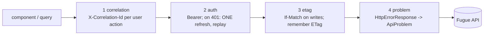

# Fugue Console

The Angular admin console for the Fugue API: customers, the audit log, users and access, modules and signed webhooks. It is built to make the API's behaviour visible: ETag/If-Match and the 412 banner, RFC 9457 problems with a correlation ref on every error, permission codes driving the UI, keyset paging, and webhook events arriving signed.

Run it: [`docs/runbooks/09-console.md`](../docs/runbooks/09-console.md). Screenshots: [`docs/screenshots/`](docs/screenshots/).

## Stack

Angular 22 (standalone components, signals, new control flow, OnPush everywhere, strict TypeScript, every screen a lazy route) · NgRx SignalStore for client state · TanStack Query (`@tanstack/angular-query`) for server state · Tailwind v4 through PostCSS · Angular CDK (dialog, menu, focus trap) with hand-built components · self-hosted Cormorant Garamond, Inter and JetBrains Mono · orval for API models · Vitest (Angular unit-test builder) and Playwright.

```
src/app/
  api/           models.ts (re-exports generated models), *.api.ts thin wrappers, generated/ (orval, committed)
  core/
    auth/        SessionStore, AuthService (single-flight refresh), AccessService (/me), guards, *hasPermission
    http/        interceptors, ETag store, correlation ids, ApiProblem
    query/       QueryClient defaults (retry, Retry-After, global mutation error toasts)
    ui/          ToastStore, PrefsStore
    forms/       server errors -> form controls
  ui/            ref chip, toasts, drawer/dialog service, skeleton/empty/error states, pipes
  features/      sign-in, shell, customers, audit, access, modules, webhooks, profile
src/styles/      tokens.css (the only place colours live), components.css
```

## Client state vs server state

| Kind | Where | Examples |
|---|---|---|
| Server state: anything the API owns | TanStack Query | `/me`, customer pages, audit entries, modules, subscriptions, deliveries, sink events |
| Client state: what only this tab knows | NgRx SignalStore | the session tokens, filters (customers, audit), UI preferences (email masking), the toast queue |

Fetched lists never enter a SignalStore. Filters live in a store, and query keys are built from them, so changing a filter is just a new key: TanStack caches each one, keeps the previous page on screen while the next loads (`keepPreviousData`) and drives "Load more" from the API's `X-Next-Cursor` header (falling back to `Link: rel="next"`) with infinite queries. Mutations invalidate by key prefix (`['customers']`, `['webhooks']`), and switching a module also invalidates `['me']`.

## The interceptor chain



1. **Correlation.** A click, Enter/Space or form submit starts a new user action with a fresh 12-hex id; every request it causes (the PUT and the refetch after it) sends that id as `X-Correlation-Id`. Background polls pin their own id. Every error toast shows it as a click-to-copy `ref` chip, and the audit log filters by it.
2. **Auth.** Adds the in-memory access token. On a 401 it calls `AuthService.refreshOnce()`: concurrent 401s share ONE refresh promise (two refreshes would present one rotating token twice, which the API treats as theft and answers by revoking the whole family), then each request is replayed once with the new token. A replay that is refused again, or a failed refresh, ends the session and returns to sign-in with the current URL.
3. **ETag.** Remembers the `ETag` per resource path from GET, 201 (keyed by `Location`) and 204 responses; lists seed it from each item's `version`. PUT, PATCH, DELETE and the state-transition POSTs (`suspend`, `reactivate`, `rotate-secret`) send it as `If-Match`. Context tokens opt out: `SEND_IF_MATCH=false` for creates, `TRACK_ETAG=false` for the 412 "peek" that reads the newer version without replacing the stale tag.
4. **Problem.** Turns every `HttpErrorResponse` into an `ApiProblem`: status, title, `code`, `errors` (keys camelCased to match form controls), correlation id (body, else response header, else the request's) and `Retry-After`. A 404 always reads "Not found", never anything that would confirm the resource exists.

Above the chain, the QueryClient retries only 429, 503 and network failures, honouring `Retry-After` (otherwise exponential backoff with jitter); mutations retry 429, and 503 only when not a POST (If-Match makes a replayed PUT or DELETE safe). A global `MutationCache.onError` shows a toast with title, code and ref unless the screen declared it handles that status (`meta.handles`): validation errors go onto form fields, 412 goes to the banner, 428 gets a developer-facing "client bug" toast.

## The 412 flow

Opening a customer GETs it, so the ETag the form saves against is the version on screen. If someone saves first, the PUT answers 412 and the drawer shows **Changed since you opened it** with `version N -> M` and the changed fields, read by a peek that deliberately does not update the tracked tag (so a stray save is still refused). **Reload their version** refetches (new tag) and refills the form; **Overwrite with mine** refetches the tag and resubmits the user's values, a deliberate last-writer-wins that the API audits like any other update.

## Permission model

- Every decision uses permission CODES from `GET /api/v1/me` (`CUSTOMERS_EDIT`, `MODULES_MANAGE`), never role names: roles are display only. The API computes the effective set (roles directly and through groups, plus allow overrides, minus deny overrides, minus switched-off modules), so the console never re-derives it.
- Navigation items, route guards (`permissionGuard`, functional, route `data.permission`) and actions (`*hasPermission="'CUSTOMERS_DELETE'"`, any-of lists, optional `else`) all read `AccessService.has()`, a computed over the `/me` query. A refetch re-renders all three.
- `/me` is refetched after sign-in, after every token refresh and on window focus. If the area on screen loses its permission (a module switched off, an override removed), the shell moves to a calm "this area was just switched off" page with a toast.
- The UI hides what you cannot do; the API still enforces everything. A self-service user's list is scoped by the API, and an out-of-scope id is a 404 there and "Not found" here.

## Token strategy and its trade-offs

- **Access token: memory only** (SessionStore signal). Never in storage, so a stored-XSS payload cannot read it from disk; it lives 15 minutes.
- **Refresh token: `sessionStorage`**, so a reload restores the session (`authGuard` calls `restore()`, which runs the single-flight refresh). It is tab-scoped and gone when the tab closes. Trade-off: script running in the page CAN read it, so XSS can still steal a refresh token. The API limits the damage (rotation on every use, reuse revokes the family, 7-day expiry, logout revokes the family). The stronger design is a backend-for-frontend that keeps the refresh token in an `HttpOnly; Secure; SameSite=Strict` cookie and never exposes it to script; that needs an API change and is the production recommendation.
- **Sign out** calls `/auth/logout` with the refresh token (always 204), clears the query cache and the ETag store.
- **No proactive refresh timer**: the first 401 after expiry triggers the refresh. It keeps the code small and is exactly the path the tests pin.

## Claims

One app, three audiences, all driven by `/me` permission codes (`src/app/features/claims/`): a claimant (`CLAIMS_SUBMIT`) reports an incident and tracks it (My claims, Report an incident, the claim with a plain-language next step, the timeline and an answer box); staff (`CLAIMS_ALL`, `CLAIMS_HANDLE`) work the queue (KPI strip and status tabs with counts, filters, keyset Load more) and act on a claim with the actions THIS status and role allow (`availableActions` mirrors the API's guards; the API still enforces them); `CLAIMS_WORKLOAD` adds Workload and `CLAIMS_EXPOSURE` adds Exposure. Claim commands carry `If-Match` through the same ETag interceptor (the command URLs map back to the claim); 412 shows the "changed since you opened it" banner with a reload, 409 shows the API's guard message. Money is bigint minor units shown with two digits and the currency code for all six currencies (not `Intl`'s own digits: it would drop IDR's decimals) and is never summed across currencies. Status counts come from the list endpoint (one page of up to 100 per status; "100+" when more remain) because the contract has no count endpoint.

## Design

Vellum: aged paper with Prussian-blue ink. Tokens in `src/styles/tokens.css` (a dark theme is a token swap); red, amber and green are status only, never brand; tints come from `color-mix()`. Text contrast is AA or better (body 14.8:1, muted 4.8:1, accent 9:1; status inks at least 5.6:1 on their tints); control borders meet 3:1. Body text is 15px with visible boundaries on every control, for a projector. The display serif carries page titles; ids, refs and diffs are mono. The one decorative idea is the fugue itself: voices entering one after another (the mark, the sign-in score, events arriving at the sink).

## Nice to haves

Two lazy routes under Claims (D-059): the **Reserve sheet** (`/claims/sheet`, `CLAIMS_HANDLE`) and the **SLA calendar** (`/claims/calendar`, `CLAIMS_READ`). Screenshots: `docs/screenshots/claims-sheet.png`, `claims-calendar.png`.

- **Reserve sheet** (Univer `@univerjs/presets` + `@univerjs/preset-sheets-core`, 1.6.2): open claims in a grid; only the Reserve column is editable (edits that start elsewhere are cancelled). The reserve is a decimal in the claim's own currency (two places at most; `12.345` is refused, never rounded). Save sends one `PUT /claims/{id}/reserve` per changed row with that row's `If-Match` from the ETag store and lists a result per row: saved; 409, the API's own guard message; 412, stale (that row is re-read, enter the amount again). A change on a claim the caller may not edit now (`availableActions`), a cleared cell or an invalid number is rejected locally and never sent. There is no bulk endpoint, so rows save one after another and one failure never stops the next. No total is shown, and nothing is summed across currencies.
- **SLA calendar** (FullCalendar 7.1.5, month and week views): one event per open claim on its due date, coloured by the status tone token, outlined when overdue, click opens the claim. Claimants see their own claims; staff can show "Assigned to me". The due date comes from one function, `slaDue()` in `src/app/features/claims/sla.ts`, constants in `SLA_DAYS`: Submitted, pickup 2 days after `submittedAt`; UnderReview, decision 14 days after `submittedAt`; InfoRequested, answer 7 days after the question's `requestedAt`; Approved, settlement 7 days after `decidedAt`. The API has no SLA field: these are console rules, not contract.
- **Bundle cost** (`npm run build`, production, numbers copied from its output; the sizes are the same code, measured before and after this lane):

| | Before | After |
|---|---|---|
| `main` (raw / estimated transfer) | 363.02 kB / 97.94 kB | 371.58 kB / 100.52 kB |
| Initial total (raw / estimated transfer) | 397.43 kB / 104.46 kB | 406.00 kB / 107.03 kB |
| `styles` | 34.41 kB / 6.51 kB | 34.41 kB / 6.51 kB (unchanged) |

  Lazy chunks added: Univer `univer-loader` 6.84 MB raw / 1.31 MB estimated transfer plus `reserve-sheet-page` 5.71 kB / 2.24 kB; FullCalendar `claims-calendar-page` 285.95 kB / 72.38 kB. Stylesheets are vendor assets, not bundles (`angular.json` assets, linked on first use by `lazy-css.ts`): Univer `index.css` 211,155 bytes (26,169 gzipped), FullCalendar skeleton, classic theme and palette 24,056 bytes together (5,301 gzipped). The build also emits 78 per-language chunks from Univer's `engine-render` (hyphenation data, the largest 765.40 kB raw); a page load of the sheet did not request any of them. Raw JS and CSS bytes loaded by a full page load of each route (production build, one run): `/claims/queue` 451,502; `/claims/sheet` 7,485,834; `/claims/calendar` 746,098.
  **The initial bundle did grow, by 8.56 kB raw (2.58 kB estimated transfer).** Neither library's own code is in it; the growth is shared rxjs modules and tslib helpers that Univer imports and the bundler hoists into `main` because the application already uses the same packages. Driving FullCalendar through the Angular wrapper (`@fullcalendar/angular`) added about another 10 kB to `main` (Angular core code the wrapper uses), so the calendar uses the framework-free `Calendar` class from `fullcalendar` instead and the wrapper is not a dependency. The build warns that Univer's `react`, `react-dom`, `ot-json1` and `@univerjs/icons-svg` are not ESM.
- **Not verified**: a 60 inch projector or a phone for the sheet (Univer is a desktop surface; the page is not tuned below tablet width), more than 500 open claims (each status is read up to five pages of 100), and the calendar in a timezone other than the browser's (events sit on the due instant; the day shown is the browser's local day).

## Commands

| Command | Does |
|---|---|
| `npm start` | dev server on 4200, proxies `/api` to 5081 |
| `npm run api:gen` | regenerate `src/app/api/generated/` from `../docs/api/openapi.v1.json` |
| `npm test` | Vitest unit tests (interceptors, problem mapping, refresh, directive) |
| `npm run lint` | angular-eslint (generated code excluded) |
| `npm run build` | production build |
| `npx playwright test` | e2e smoke (412 flow) and screenshots, against the live API |
